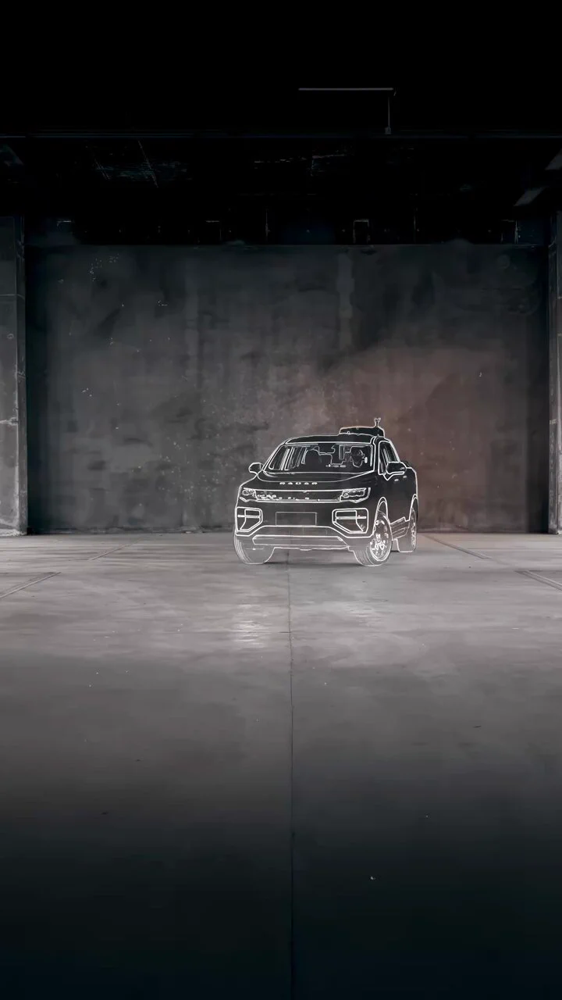

## 여러 현장을 순회 점검한다면, 드론 도크를 어디에 배치해야 할까요?

태양광 단지, 변전 설비, 건설 현장이 서로 떨어져 있다면 각 현장에 자동 드론 도크를 고정 설치하는 방식만이 답은 아닙니다. 점검 대상이 분산돼 있고 현장마다 방문 빈도가 다르다면 **고정형 배치와 차량 탑재형 이동 배치를 비교**할 필요가 있습니다. 이동할 수 있다는 기능 설명과 실제로 여러 현장을 안전하게 운영할 수 있다는 검증은 다른 문제입니다.

DJI Enterprise는 [2026년 10월 31일 공식 X 게시물](https://x.com/DJIEnterprise/status/2116500993588212105)에서 Dock 3를 차량에 탑재해 현장 간 이동하며 사용하는 방식을 소개했습니다. 이는 기존 제품의 운용 방식에 관한 **제조사 소개**이지, 신규 제품 출시나 국내 현장 실증 결과는 아닙니다. [DJI Dock 3 제품 페이지](https://enterprise.dji.com/dock-3) 역시 차량 탑재형 이동 배치를 지원한다고 명시합니다.

출처: [DJI Enterprise 공식 X, Dock 3 차량 이동 운용 게시물](https://x.com/DJIEnterprise/status/2116500993588212105), 2026년 10월 31일. 원 게시물 영상의 대표 이미지이며 실제 고객 현장 실증 사진은 아닙니다.

## 고정형과 이동형은 점검 주기가 다릅니다

동일한 설비를 짧은 주기로 반복 촬영하고 경보에 대응해야 한다면, 해당 현장에 도크를 고정 배치하는 구성이 검토 대상입니다. 반대로 여러 현장을 순차 방문해 정기 상태를 기록한다면 차량 탑재형 배치가 후보가 될 수 있습니다. 어느 쪽이 더 저렴하거나 빠르다고 단정할 수는 없습니다. 도크 설치 가능 장소, 이동 시간, 현장별 비행 가능 조건과 데이터 전달 방식을 합산해야 하기 때문입니다.

특히 **차량 탑재형은 주행 중 비행하는 방식이 아닙니다.** [DJI 공식 FAQ](https://enterprise.dji.com/dock-3/faq)는 비행 중 차량과 도크를 움직이지 말 것, 운용 시 주차 경사도가 3° 미만일 것, 비행 전에 클라우드에서 도크 원격 보정을 마칠 것을 안내합니다. 이동 후 곧바로 어디서나 이륙할 수 있다는 뜻으로 받아들여서는 안 됩니다.

## 현장에 도착한 뒤 확인해야 할 조건

여러 현장을 순회하는 시설 점검이라면 출동 계획을 세우기 전에 다음을 현장별로 확인해야 합니다.

- **주차·고정:** 안전한 차량 정차 장소, 운용 중 이동 방지, 차량용 마운트 고정 상태와 이착륙 주변 장애물을 확인합니다. DJI FAQ는 차량 탑재 시 장착 브래킷 고정, 잠금 너트, 안전 로프와 차량용 짐벌 마운트 설치를 안내합니다.
- **전원·통신:** 도크와 기체의 전원 공급, 현장 인터넷 연결 및 영상 전송 품질을 실제 배치 지점에서 확인합니다. 제조사 FAQ는 설치 환경에 안정적인 전원과 인터넷을 요구합니다. 현장의 전력·통신 인프라가 부족하면 별도 설계가 필요합니다.
- **운용·허가:** 현장별 비행 가능 공역, 이착륙 장소 사용 권한, 안전관리, 원격 운용 조건과 촬영 대상의 보안 요구를 검토합니다. 제품이 차량 탑재를 지원한다는 설명만으로 국내 운항이나 차량 개조에 관한 승인이 완료되는 것은 아닙니다.
- **자료 인계:** 설비 ID, 방문 날짜, 촬영 위치와 이상 발견 시 담당자 전달 경로를 정합니다. 동일한 대상을 같은 기준으로 촬영하지 않으면 현장 간·시점 간 비교가 어려워집니다.

이 항목은 제조사가 입증한 서비스 성과가 아니라, 실제 프로젝트에서 고객과 함께 확인해야 할 **도입 검토 기준**입니다. 차량 탑재형과 고정형 모두 점검 영상만으로 설비 고장 판정을 자동 확정하거나 법정 안전검사를 대신하지 않습니다.

아이엠드론은 고객의 설비 분포와 점검 주기를 먼저 확인하고, 항공 촬영으로 확보할 수 있는 기록과 현장 근접 확인이 필요한 항목을 구분하도록 돕겠습니다. 도크 도입을 검토하는 경우에도 이동·설치·비행·철수에 필요한 조건과 데이터 인계 방식을 함께 정의해야, 여러 현장의 촬영 자료를 실제 유지관리 업무에 연결할 수 있습니다.

## 참고한 공식 자료

- DJI Enterprise 공식 X, [Dock 3 차량 탑재 이동 운용 소개 게시물](https://x.com/DJIEnterprise/status/2116500993588212105), 2026년 10월 31일. 본문 이미지의 원 출처.
- DJI Enterprise, [“DJI Dock 3 - Rise to Any Challenge” 제품 페이지](https://enterprise.dji.com/dock-3), 2026년 11월 1일 확인. 차량 탑재형 이동 배치 지원 설명.
- DJI Enterprise, [“DJI Dock 3 - FAQ”](https://enterprise.dji.com/dock-3/faq), 2026년 11월 1일 확인. 차량 탑재 설치·운용 조건과 전원·인터넷 환경 안내.
