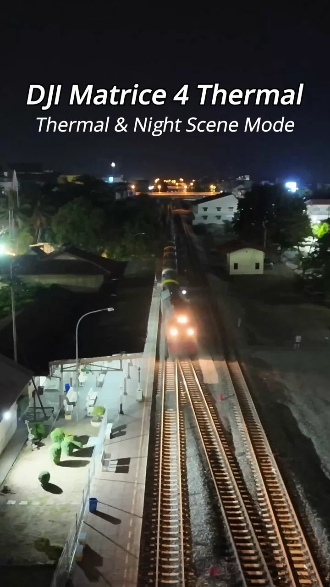

## 철도 야간 점검, 열화상과 가시광 영상을 같은 기록으로 보지 마세요

야간 선로 주변을 드론으로 관찰할 때 필요한 것은 ‘밤에도 잘 보이는 화면’ 한 장이 아닙니다. **열 분포를 보는 영상**과 **주변 구조와 위치를 읽는 저조도 가시광 영상**은 서로 다른 질문에 답합니다. 두 영상을 같은 점검 결과로 묶어 버리면, 발견한 장면이 어느 구간의 무엇을 가리키는지 담당자가 다시 확인하기 어렵습니다.

DJI Enterprise는 [2026년 11월 1일 공식 게시물](https://x.com/DJIEnterprise/status/2116817608913633336)에서 Matrice 4T를 활용한 철도 야간 촬영 예시를 소개하며 열화상 모드는 선로 주변의 열 패턴을, Night Scene 모드는 저조도 환경의 컬러 디테일을 보여 준다고 설명했습니다. **제조사의 촬영 예시**이며 철도 결함을 실제로 찾아냈다는 독립 검증이나 국내 운영 실적은 아닙니다.

출처: [DJI Enterprise 공식 X, Matrice 4T 철도 야간 촬영 게시물](https://x.com/DJIEnterprise/status/2116817608913633336), 2026년 11월 1일. 공식 게시물 영상의 미리보기 이미지로, 진단 결과를 입증하는 사진은 아닙니다.

## 서로 다른 화면이 답하는 질문

열화상은 촬영 구간의 **상대적인 열 패턴을 관찰**하는 데 쓰입니다. 그러나 밝게 나타난 부위가 곧바로 결함이라는 뜻은 아닙니다. 주변 온도와 반사, 표면 재질, 촬영 거리 및 카메라 설정이 해석에 영향을 줄 수 있습니다. 야간 촬영 영상만으로 레일이나 전기 설비의 고장을 확정해서는 안 됩니다.

저조도 가시광 영상은 화면 속 구조물의 형태와 주변 맥락을 확인하는 데 도움이 됩니다. [DJI Matrice 4 시리즈 제품 설명](https://enterprise.dji.com/matrice-4-series)은 Night Scene의 풀컬러 야간 촬영 기능을 안내합니다. 다만 제품 기능 설명이 곧 특정 현장에서 모든 표지·부품을 식별할 수 있다는 보증은 아닙니다. 현장 조명과 촬영 거리, 가림 조건에 따라 실제 판독 가능 범위를 확인해야 합니다.

## 영상에서 조치 가능한 기록으로

철도나 선형 인프라처럼 길게 이어진 시설은 영상만 모아 두면 이상 장면을 재방문하기 어렵습니다. 점검 업무에 활용하려면 촬영 구간, 시간, 위치 또는 시설물 식별자, 영상 모드, 촬영 거리와 설정을 함께 기록하고 같은 위치의 가시광·열화상 장면을 서로 대응시켜야 합니다. 이는 위 제조사 게시물이 입증한 성과가 아니라, 현장에 맞춰 설계해야 할 **자료 인계 방식**입니다.

열 패턴이 눈에 띄는 지점을 발견했다면 담당자가 해당 구간을 확인할 수 있도록 원본 영상과 위치 정보를 전달하고, 필요할 때 지상 근접 점검이나 전문 진단으로 연결해야 합니다. 열화상 촬영은 철도 시설의 법정 검사나 결함 판정을 대체하지 않습니다. 선로 주변 비행의 허가·안전거리·시설 관리자 협의도 장비 성능과 별개로 검토해야 합니다.

아이엠드론은 야간 시설 점검을 검토하는 고객과 함께 **무엇을 영상으로 관찰하고, 어떤 장면을 현장 담당자에게 인계할지** 먼저 정의합니다. 드론 촬영으로 확보한 열·가시광 기록을 구간별로 정리하고, 추가 확인이 필요한 항목은 전문 점검 절차와 구분해 실제 유지관리 의사결정에 연결하도록 돕겠습니다.

## 참고한 공식 자료

- DJI Enterprise 공식 X, [“Railway inspection at night with the DJI Matrice 4T drone” 게시물](https://x.com/DJIEnterprise/status/2116817608913633336), 2026년 11월 1일. 본문 영상 미리보기 이미지의 원 출처.
- DJI Enterprise, [“DJI Matrice 4 Series — The Age of Intelligent Flight”](https://enterprise.dji.com/matrice-4-series), 2026년 11월 2일 확인. Night Scene 기능 설명.
