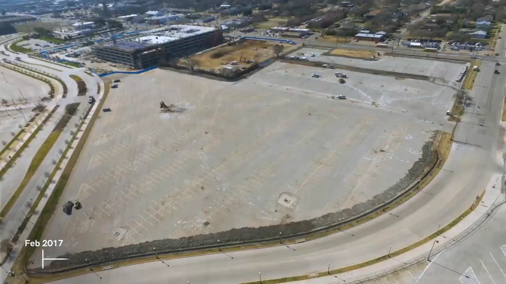
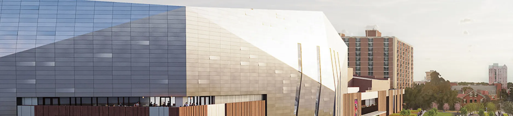

## 공정 사진은 쌓이는데, 지난주와 비교할 수 있나요?

건설 현장의 드론 촬영은 멋진 준공 영상 한 편으로 끝나지 않습니다. 기초가 타설되기 전, 철골이 올라가는 동안, 덮이면 다시 볼 수 없는 공정마다 **같은 구역을 언제 어떤 방식으로 기록했는지** 남겨야 현장 담당자와 발주처가 같은 자료를 보고 이야기할 수 있습니다.

DroneDeploy는 [2026년 11월 2일 Ariat Arena 건설을 되돌아보는 공식 게시물](https://x.com/DroneDeploy/status/2117297930684313803)에서 드론 비행으로 공사 진행을 연속 기록했다고 소개했습니다. 이는 **7년 전 개장한 시설을 회고한 게시물**이지, 새로 시작된 공사나 드론 활용 효과를 검증한 연구가 아닙니다. 게시물에 언급된 노동 투입 규모와 준공 시점도 드론 촬영 덕분에 달성했다는 근거로 읽어서는 안 됩니다.

출처: [DroneDeploy 공식 X, Ariat Arena 건설 기록 회고 게시물](https://x.com/DroneDeploy/status/2117297930684313803), 2026년 11월 2일. 게시물 동영상의 미리보기 이미지이며 측량·공정 검증 자료가 아닙니다.

## 기록이 쌓일 수 있는 촬영 간격과 시점을 정하세요

반복 촬영의 운영 방식은 [DroneDeploy가 2026년 8월 소개한 PCL Construction의 *별도 프로젝트*, 미국 New Augusta Arena](https://dronedeploy.com/blog/pcl-construction-captures-every-phase-of-10-500-seat-new-augusta-arena-with-dronedeploy)에서 더 구체적으로 확인할 수 있습니다. DroneDeploy가 전한 PCL 담당자의 설명에 따르면 이 현장은 **7~10일마다 드론 비행**, **주 1회 이상 360도 현장 순회**, **상부 슬래브 콘크리트 타설 전 드론 촬영**을 실시했습니다. 고정식 타임랩스 카메라까지 더해 철거, 굴착, 기초 콘크리트, 철골 공정을 기록했다고 설명합니다. 이 수치는 해당 현장의 운영 사례이지 모든 건설 현장에 적용할 표준 주기는 아닙니다.

출처: [DroneDeploy, PCL Construction의 New Augusta Arena 현장 기록 사례](https://dronedeploy.com/blog/pcl-construction-captures-every-phase-of-10-500-seat-new-augusta-arena-with-dronedeploy), 2026년 8월. 원문 기사 이미지입니다.

고객 현장에는 정해진 숫자를 그대로 가져오기보다 **결정이 필요한 공정에 촬영 시점을 맞추는 일**이 먼저입니다. 굴착면이나 매립 전 설비처럼 곧 가려질 곳은 정기 촬영을 기다릴 수 없습니다. 반대로 단순 주간 경과 공유에는 같은 구역을 같은 범위로 되풀이해 촬영하는 편이 유용합니다. 항공촬영으로 외부 전경을 남기고, 건물 내부나 가려진 설비는 지상 근접 사진·360도 기록으로 보완해야 합니다.

## 사진 파일을 ‘찾을 수 있는 공정 기록’으로

촬영한 영상만 날짜별 폴더에 넣어 두면 지난번과 지금의 어느 위치가 달라졌는지 찾는 데 시간이 듭니다. 구역·공정·촬영일·촬영 위치를 함께 정리하고, 비교가 필요한 지점은 같은 기준의 시야로 연결해야 합니다. DroneDeploy의 [건설 매핑 소프트웨어 설명](https://dronedeploy.com/blog/construction-mapping-software-that-actually-improves-jobsite-performance)은 촬영 결과를 위치와 날짜에 연결해 조회·비교하는 방식을 소개합니다. 실제 현장 적용에서는 비행 경로, 촬영 고도, 지상 기준점과 위치 정합 수준을 목적에 따라 별도로 정해야 합니다.

**진행 현황 공유용 사진과 치수 검증용 자료는 다릅니다.** 여러 날의 사진이 겹쳐 보인다고 해서 그 자체로 측량 정확도가 보장되지는 않습니다. 정사영상이나 3D 결과물의 거리·면적·체적을 계약·검측에 사용한다면 기준점과 독립 검증을 포함한 정확도 확인이 필요합니다. 도면과 영상이 다르게 보일 때도 즉시 시공 오류라고 단정하지 않고 촬영 시점과 기준 좌표부터 확인해야 합니다.

아이엠드론은 고객 현장의 **공정별 확인 시점과 전달 대상**을 먼저 살펴보고, 반복 항공촬영과 필요한 지상 기록을 구분해 제공합니다. 현황 공유에 필요한 사진, 위치를 확인할 수 있는 지도 기반 기록, 별도 검증이 필요한 측정 자료를 목적에 맞게 나눠, 현장에 남겨야 할 변화가 다음 의사결정까지 이어지도록 돕겠습니다.

## 참고한 공식 자료

- DroneDeploy 공식 X, [Ariat Arena 건설 기록 회고 게시물](https://x.com/DroneDeploy/status/2117297930684313803), 2026년 11월 2일(UTC). 게시물 영상 미리보기 이미지의 출처.
- DroneDeploy, [“PCL Construction captures every phase of 10,500-seat Augusta Arena Construction with DroneDeploy”](https://dronedeploy.com/blog/pcl-construction-captures-every-phase-of-10-500-seat-new-augusta-arena-with-dronedeploy), 2026년 8월(기사 본문 발표일 18일). 원문 배너 이미지의 출처.
- DroneDeploy, [“Construction mapping software that actually improves jobsite performance”](https://dronedeploy.com/blog/construction-mapping-software-that-actually-improves-jobsite-performance), 2026년 2월 13일.
