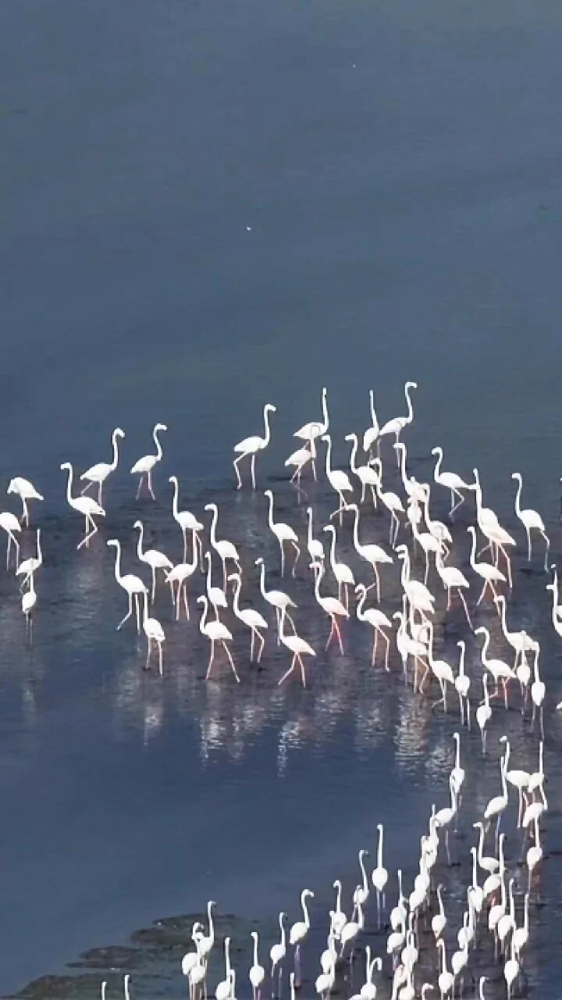

## 습지의 새를 셀 때, 드론과 AI만으로 충분할까요?

습지에서 야생동물의 개체 수와 둥지 위치를 파악하려면 넓은 지역을 반복해서 관찰해야 합니다. 하지만 사람이 현장에 들어가는 횟수를 줄이는 것만으로 조사가 끝나지는 않습니다. **촬영 자료를 어떻게 검수하고, 다음 조사와 비교할 수 있게 남길지**가 중요합니다.

DJI Enterprise는 **2026년 11월 4일** [공식 게시물](https://x.com/DJIEnterprise/status/2117912520283308242)에서 Matrice 4TD로 촬영한 영상과 AI 모델을 이용해 플라밍고를 세고 둥지 위치를 파악하는 활용 예시를 소개했습니다. DJI는 이 방식이 민감한 습지 지면에서의 인력 활동을 줄이는 데 도움이 된다고 설명합니다. 영상 제작 크레딧은 Aeronex FZCO입니다. 다만 게시물에는 대상지, 촬영 표본, AI 계수 정확도나 교란 감소량이 제시되지 않습니다. 특정 현장에서 검증된 조사 성과로 해석해서는 안 됩니다.

출처: [DJI Enterprise 공식 X 게시물](https://x.com/DJIEnterprise/status/2117912520283308242), 2026년 11월 4일. 영상 제작: Aeronex FZCO. 공식 게시물의 영상 미리보기 이미지입니다.

## 촬영과 개체 수 판정은 서로 다른 단계입니다

항공영상은 사람이 현장에서 일일이 접근하지 않고도 조사 구역을 기록하는 수단입니다. AI로 영상 속 개체와 둥지 **후보**를 표시하면 검토할 위치를 찾는 데 활용할 수 있습니다. 그러나 영상에서 가려진 대상, 비슷하게 보이는 지형·개체, 같은 대상을 여러 프레임에서 중복 집계하는 문제는 별도 확인이 필요합니다. 이 항목은 DJI 게시물이 입증한 성능이 아니라, 조사 결과를 고객에게 인계하기 전에 점검해야 할 실무 조건입니다.

따라서 납품할 때는 영상 원본과 촬영 시점·구역, AI가 표시한 후보 목록, 사람이 확인한 최종 집계, 판정이 어려운 구역을 구분하는 편이 안전합니다. **AI 결과를 확정 개체 수로 바로 바꾸지 않는 것**이 핵심입니다.

## 다음 조사와 비교하려면 조사 조건도 남겨야 합니다

한 번의 영상에서 둥지를 찾는 일과 여러 시점의 변화를 비교하는 일은 다릅니다. 비교 목적이라면 조사 구역의 경계, 촬영 시기와 관측 조건, 사용한 영상의 범위, 검수 기준을 조사 회차마다 함께 기록해야 합니다. 같은 지역이라도 관측 가능한 범위가 달라지면 단순한 집계 차이를 개체 수 변화로 단정할 수 없습니다. 민감한 서식지에서는 촬영·접근 관련 허가와 현장 관리 기준도 조사 계획에서 먼저 확인해야 합니다.

아이엠드론은 환경 조사 목적에 맞춰 **촬영 범위와 반복 기록 방식**을 설계하고, 영상·위치 정보가 후속 검수와 비교에 쓰일 수 있도록 자료를 구성하겠습니다. AI 계수의 적합성과 최종 생태학적 판정은 해당 현장의 조사 기준과 전문가 검증을 거쳐 확인해야 합니다.

## 참고한 공식 자료

- DJI Enterprise, [플라밍고 개체 계수·둥지 위치 파악에 Matrice 4TD 영상과 AI를 활용한 소개 게시물](https://x.com/DJIEnterprise/status/2117912520283308242), 2026년 11월 4일. 영상 크레딧: Aeronex FZCO. 본문의 사례 설명 및 이미지 출처. 계수 정확도나 교란 감소량은 공개되지 않았습니다.
