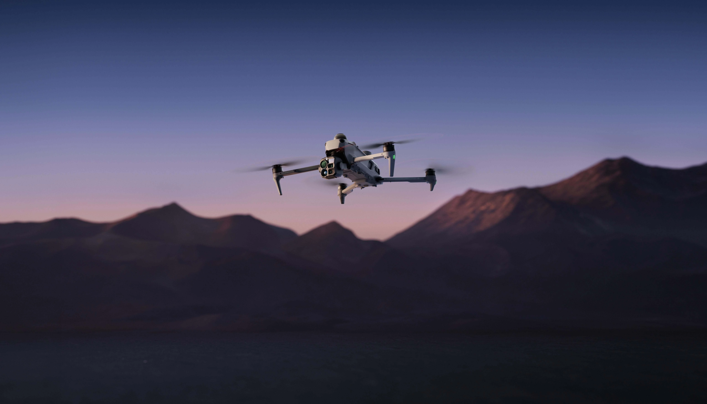

## 태양광 열화상 점검, ‘뜨거운 사진’에서 설비별 이상 기록으로

태양광 설비 점검에서 열화상 화면에 밝은 부분이 보인다고 곧바로 고장 판정을 내릴 수는 없습니다. 고객에게 필요한 것은 **어느 설비의 어느 위치에서 이상 후보가 관찰됐는지**, 현장에서 다시 확인할 수 있는 자료입니다. 가시광 사진, 열화상 영상, 위치 정보와 촬영 조건을 함께 남겨야 점검 결과가 후속 정비로 이어집니다.

DJI는 **2026년 11월 5일** Matrice 5T를 발표했습니다. 제조사 자료에 따르면 기체에는 기본 해상도 **1280×1024 열화상 카메라**와 저조도 가시광 카메라, LiDAR·밀리미터파 레이더·전방향 비전 센서가 탑재됩니다. DJI는 DJI Terra에서 열화상 이미지를 2D 지도로 결합해 온도를 읽고 이상 위치를 표시하는 작업도 소개합니다. 이는 제조사의 제품 기능 설명이지 국내 태양광 현장에서 확인된 점검 성과는 아닙니다.

출처: [DJI 공식 Matrice 5T 출시 발표](https://www.dji.com/media-center/announcements/dji-release-matrice-5t), 2026년 11월 5일. 이미지: DJI.

## 열화상 해상도가 높아져도 ‘판정’은 별개입니다

DJI Enterprise Insights는 태양광 설비에서 높은 열화상 해상도가 열 이상이 나타난 구역을 더 세밀하게 찾는 데 도움이 될 수 있다고 설명합니다. 하지만 화면에 나타난 온도 차이만으로 불량 패널이나 전기적 원인을 확정할 수는 없습니다. 일사량, 바람, 운전 상태, 촬영 거리·각도, 반사와 방사율 등 현장 조건을 함께 확인해야 합니다. 이런 조건 관리는 제조사가 제시한 성능 수치를 실제 점검 결과에 연결하기 위한 실무 검증 항목입니다.

아이엠드론은 점검 목적에 맞춰 **열 이상 후보의 위치 표시 → 해당 설비의 가시광 사진 대조 → 재확인 대상 목록 작성**으로 이어지는 자료 구성을 지원합니다. 최종 고장 진단과 정비 우선순위는 설비 운영 데이터와 현장 확인을 결합해 결정해야 합니다.

출처: [DJI Enterprise Insights, Matrice 5T 기능 해설](https://enterprise-insights.dji.com/blog/dji-matrice-5t-everything-you-need-to-know), 2026년 11월 5일. 이미지: DJI Enterprise.

## 지도에 표시한 이상 위치를 정비 대상과 연결하려면

열화상 2D 지도는 넓은 단지를 훑고 후보 위치를 공유하는 데 유용할 수 있습니다. 다만 지도상의 점 하나만 전달하면 유지관리 담당자가 현장에서 해당 모듈이나 스트링을 다시 찾기 어렵습니다. 점검 계획 단계에서 설비 구역·스트링·모듈 식별 체계와 도면의 기준을 확인하고, 결과물에는 촬영 시각, 원본 영상 또는 사진, 후보 위치, 가시광 대조 자료, 확인 여부를 함께 연결해야 합니다.

DJI가 설명한 측량 정확도와 지도 제작 속도는 제조사 조건에 따른 수치입니다. 실제 현장에서는 위치 정합과 온도 판독을 별도로 검증해야 하며, 무조건적인 위치 정확도나 불량 판별률을 보장하는 자료로 사용해서는 안 됩니다. 전력 설비 주변 비행에서는 전선 감지 기능만 믿고 접근하기보다 안전거리, 장애물 및 통신 조건을 사전에 검토해야 합니다.

**점검 결과는 ‘열화상 사진 몇 장’이 아니라 재확인 가능한 설비별 기록이어야 합니다.** 아이엠드론은 촬영 범위와 결과물의 식별 기준을 고객 설비 관리 방식에 맞춰 설계하고, 이상 후보가 현장 재점검과 정비 계획으로 이어질 수 있도록 지원합니다.

## 참고한 공식 자료

- DJI, [“DJI Matrice 5T Uplevels Intelligent Aerial Operations, Day or Night for Challenging Missions”](https://www.dji.com/media-center/announcements/dji-release-matrice-5t), 2026년 11월 5일. 기체 사양 및 DJI Terra 열화상 지도 기능, 첫 번째 이미지 출처. 최대 비행시간·측량 정확도 등은 제조사 통제 조건 기준입니다.
- DJI Enterprise Insights, [“DJI Matrice 5T Drone: Everything You Need to Know”](https://enterprise-insights.dji.com/blog/dji-matrice-5t-everything-you-need-to-know), 2026년 11월 5일. 태양광 설비 활용 설명 및 두 번째 이미지 출처. 현장별 점검 정확도에 관한 독립 실증 자료는 아닙니다.
