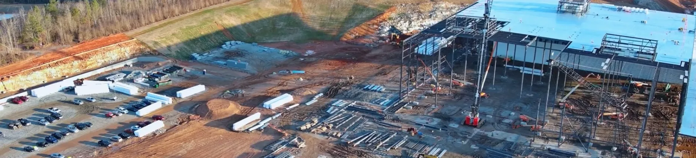
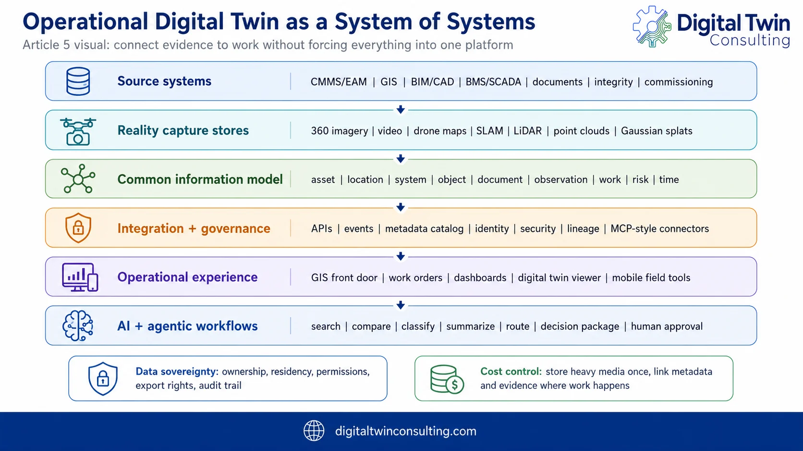

## 드론 지도는 어디에 저장되나요? 운영형 디지털 트윈을 위한 데이터 인계

현장에 드론 지도와 점검 사진이 쌓여도, 다음 점검 때 담당자가 자산번호로 이전 사진을 찾지 못한다면 기록은 다시 촬영해야 하는 자료가 됩니다. 건설 현장의 준공 기록이나 시설물 점검 자료를 장기적으로 활용하려면 **촬영 결과를 고객이 이미 사용하는 자산·공간·작업 기록에 연결하는 방법**부터 정해야 합니다.

2026년 11월 4일 DroneDeploy 공식 블로그에 실린 Kelly Watt의 기고문은 이 문제를 ‘현실 캡처 데이터에서 운영형 디지털 트윈으로 넘어가는 인계’로 설명합니다. 글은 드론 지도뿐 아니라 360도 영상, 점군, 설계 도면, 시설관리 시스템의 역할을 구분합니다. 특정 현장에서 비용 절감이나 점검 정확도가 입증됐다는 실증 보고서는 아닙니다.

출처: [DroneDeploy, Kelly Watt 기고문](https://www.dronedeploy.com/blog/from-a-reality-capture-data-fabric-to-an-operational-digital-twin), 2026년 11월 4일. 이미지: DroneDeploy.

## 한 시스템에 모든 파일을 넣는 것이 답은 아닙니다

원문은 시설관리 시스템(CMMS/EAM)에 자산과 작업지시 이력을, GIS에 공간·위치 정보를, BIM/CAD에 설계·도면 정보를, 현실 캡처 저장소에 드론 지도·영상·점군 원본을 두고 서로 연결하는 구조를 제시합니다. **운영형 디지털 트윈은 예쁜 3D 화면 한 장이 아니라, 현장 증거가 실제 업무 기록에서 다시 열리는 연결 구조**라는 뜻입니다.

예를 들어 옥상 배수구를 점검한다면 사진 파일명만 전달하는 대신 건물·층 또는 구역, 배수구 자산 ID, 촬영 날짜, 이상 후보 위치, 원본 링크, 확인 담당자와 조치 상태를 함께 지정할 수 있습니다. 이는 원문의 배수구·자산 연계 설명을 현장 인계 항목으로 풀어 쓴 예시이며, 특정 고객 현장에서 구현된 사례를 뜻하지 않습니다.

출처: [DroneDeploy, Kelly Watt 기고문 Figure 13 ‘The operational digital twin should be designed as a system-of-systems’](https://www.dronedeploy.com/blog/from-a-reality-capture-data-fabric-to-an-operational-digital-twin), 2026년 11월 4일. 원본 PNG를 WebP로 변환. 이미지: DroneDeploy.

## 점검 결과를 넘길 때 먼저 맞출 네 가지

- **자산 식별:** 고객이 실제로 쓰는 설비번호·구역명을 확인하고, 지도상의 표식과 사진이 같은 대상을 가리키는지 대조합니다. 자동 분류 결과라면 확인 전에는 ‘후보’로 표시해야 합니다.
- **촬영 시점과 위치:** 촬영일·좌표계·기준 도면·촬영 범위를 기록합니다. 다른 시기의 항공 지도를 비교하려면 위치 정합의 오차도 별도로 확인해야 합니다.
- **원본과 요약의 위치:** 대용량 정사영상·점군은 적합한 저장소에 두고, 작업지시에는 검증된 발견 사항과 원본 링크·썸네일 등 필요한 정보만 연결합니다. 자료 접근 권한과 보존기간도 합의해야 합니다.
- **후속 확인:** 이상 후보가 누구에게 전달되고 누가 현장 확인·작업 완료를 기록하는지 정합니다. AI가 표식을 찾거나 보고서를 초안으로 만들어도 최종 판단과 조치 승인에는 사람이 남아야 합니다.

이 목록은 DroneDeploy 기고문의 자산 식별, 저장소 분리, 근거 추적, 인적 검토 원칙을 바탕으로 구성한 **인계 설계 항목**입니다. 모든 고객 시스템에 즉시 연동된다는 뜻은 아닙니다. 실제 연계 범위는 기존 GIS·시설관리 체계와 데이터 접근 조건을 확인한 뒤 결정해야 합니다.

아이엠드론은 촬영 목적에 맞는 위치·자산 식별 기준과 결과물 구성을 고객과 함께 검토하고, 드론 촬영 자료가 다음 점검에서도 재검색 가능한 현장 기록이 되도록 돕겠습니다. 먼저 ‘어떤 설비에 대한 어떤 결정을 지원해야 하는가’를 정하면 필요한 촬영 방식과 인계 형식도 분명해집니다.

## 참고한 공식 자료

- DroneDeploy, Kelly Watt, [“From a reality capture data fabric to an operational digital twin”](https://www.dronedeploy.com/blog/from-a-reality-capture-data-fabric-to-an-operational-digital-twin), 2026년 11월 4일. 시스템 간 연계·공통 자산 식별·GIS/CMMS 역할·원본 저장·검토 절차 설명 및 본문 이미지 출처. 개별 현장 성과를 검증한 자료가 아닌 기고문입니다.
