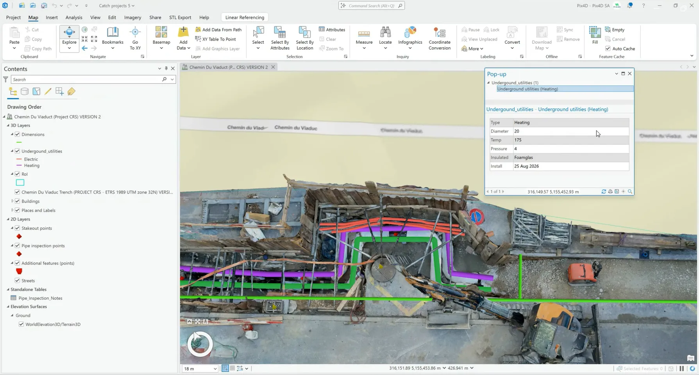
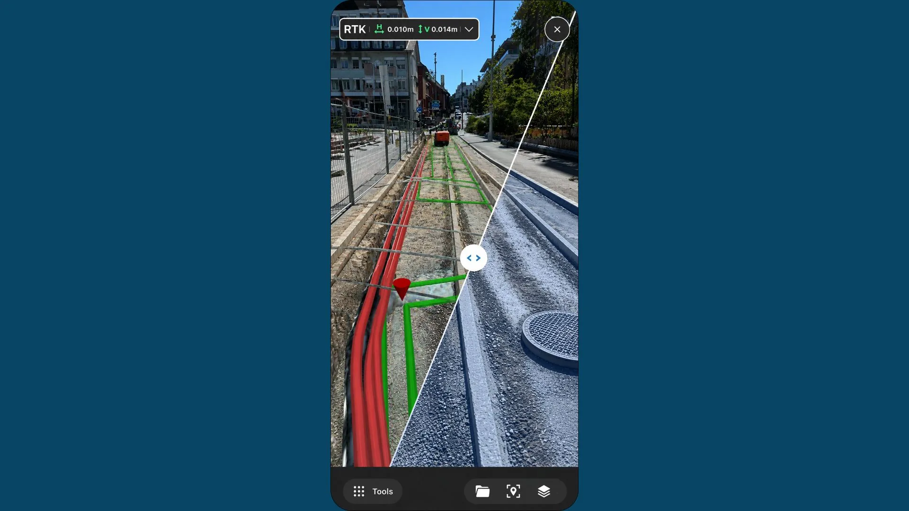

## GIS에 있는 설비, 현장에서 같은 위치를 찾을 수 있나요?

관로와 설비 위치를 GIS에 기록해 두어도, 현장 작업자가 지도 속 자산과 눈앞의 위치를 연결하기 어려울 때가 있습니다. 특히 매설 이후에는 지표 사진만으로 당시의 배관 위치나 접합부 상태를 다시 확인할 수 없습니다. **필요한 것은 3D 기록을 만드는 일뿐 아니라, 그 기록을 작업 현장에서 다시 찾고 검증하는 흐름**입니다.

2026년 9월 14일 PIX4D가 공개한 [PIX4Dcatch와 기업 GIS 연계 소개](https://www.pix4d.com/blog/geoferenced-3d-context-enterprise-gis/)는 현장 3D 캡처 자료를 ArcGIS로 보내고, 기존 GIS 자산을 현장 AR 화면에 겹쳐 보는 두 방향의 활용을 설명합니다. 이는 제품 기능 설명이며 국내 사업장의 정확도나 안전 효과를 검증한 실증 결과는 아닙니다.

## 기록을 사무실로 보내는 방향: 현장 3D와 자산 정보 연결

원문에 따르면 작업자는 PIX4Dcatch로 현장 상태를 3D로 캡처하고, 위치가 연결된 결과를 ArcGIS에서 확인할 수 있습니다. 매설 전 노출된 관로처럼 나중에 보이지 않을 요소의 접합부 위치나 지표와의 관계를 시각적으로 남기는 데 의미가 있습니다. 아래 이미지는 원문에 실린 ArcGIS 화면입니다.

출처: [PIX4D Blog, “PIX4Dcatch: georeferenced 3D context for enterprise GIS”](https://www.pix4d.com/blog/geoferenced-3d-context-enterprise-gis/), 2026년 9월 14일. 원문 PNG를 WebP로 변환.

고객이 이 자료를 다음 정비에 활용하려면 단순 파일 업로드보다 **자산 ID, 작업 위치, 촬영일, 좌표계, 확인 담당자와 원본 링크**를 같은 기준으로 관리해야 합니다. 이 항목들은 원문의 현장·사무실 연계를 실제 인계 과정에 적용하기 위해 아이엠드론이 권하는 설계 기준이며, PIX4D가 모든 현장에 자동으로 부여한다고 주장하는 기능은 아닙니다.

## 기록을 현장으로 돌려보내는 방향: GIS 자산을 AR로 확인

PIX4D는 기존 GIS 자산의 위치와 자산 종류·설치일·작업지시 같은 속성을 AR 화면에서 조회하고, 지정된 자산 위치를 안내하는 기능을 설명합니다. 현장 팀은 단면도나 2D 지도의 선을 해석하는 데서 그치지 않고, 기록된 대상이 실제 작업 구역과 어떻게 겹치는지 살펴볼 수 있습니다.

출처: [PIX4D Blog, “PIX4Dcatch: georeferenced 3D context for enterprise GIS”](https://www.pix4d.com/blog/geoferenced-3d-context-enterprise-gis/), 2026년 9월 14일. 원문 JPG를 WebP로 변환.

단, 화면에 표시된 선을 곧바로 굴착 승인 근거로 삼아서는 안 됩니다. 매설물은 기록 이후 이전·변형됐을 수 있고, 좌표 기준이나 현장 위치 정합에도 오차가 생길 수 있습니다. 굴착 전에는 해당 구역의 최신 도면, 현장 탐사·표시 및 관계 기관의 안전 절차에 따라 실제 위치를 확인해야 합니다. **AR은 확인을 돕는 화면이지 매설물 탐사나 안전 판단의 대체물이 아닙니다.**

## 드론 촬영과 지상 캡처는 역할이 다릅니다

이 PIX4D 사례의 핵심 촬영 장비는 **스마트폰 기반 지상 캡처**입니다. 드론만으로 매설 관로의 세부를 촬영하거나 AR 화면을 구현한다는 사례가 아닙니다. 드론은 넓은 공사 구역의 지형·진도와 접근 경로를 반복 기록하고, 지상 캡처는 개착부와 접합부처럼 가까이에서 봐야 할 요소를 기록하는 식으로 역할을 나눌 수 있습니다. 두 자료를 하나의 GIS에서 비교하려면 같은 좌표계와 검증된 기준점, 촬영 시점 및 자산 식별 체계가 필요합니다. 이는 원문 기능을 바탕으로 한 적용 방안이지, 두 시스템의 연동 성능이 검증됐다는 뜻은 아닙니다.

아이엠드론은 고객의 시설물·공사 현장에서 **어떤 자산을 언제 기록하고, 누가 현장에서 다시 찾아야 하는지**부터 확인하겠습니다. 항공 기록과 지상 3D 자료가 필요한 범위를 구분하고, 기존 GIS와 인계 가능한 데이터 형식 및 위치 검증 방법을 함께 검토하겠습니다.

## 참고한 공식 자료

- PIX4D Blog, [“PIX4Dcatch: georeferenced 3D context for enterprise GIS”](https://www.pix4d.com/blog/geoferenced-3d-context-enterprise-gis/), 화면 표시 2026년 9월 14일(페이지 구조화 데이터에는 9월 15일 표기). PIX4Dcatch의 지상 3D 캡처, ArcGIS 연계, 현장 AR 자산 조회 소개 및 본문 이미지 출처. 현장별 실제 오차·안전 성과를 입증한 자료는 아닙니다.
