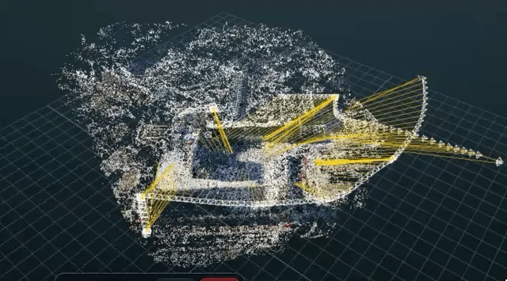
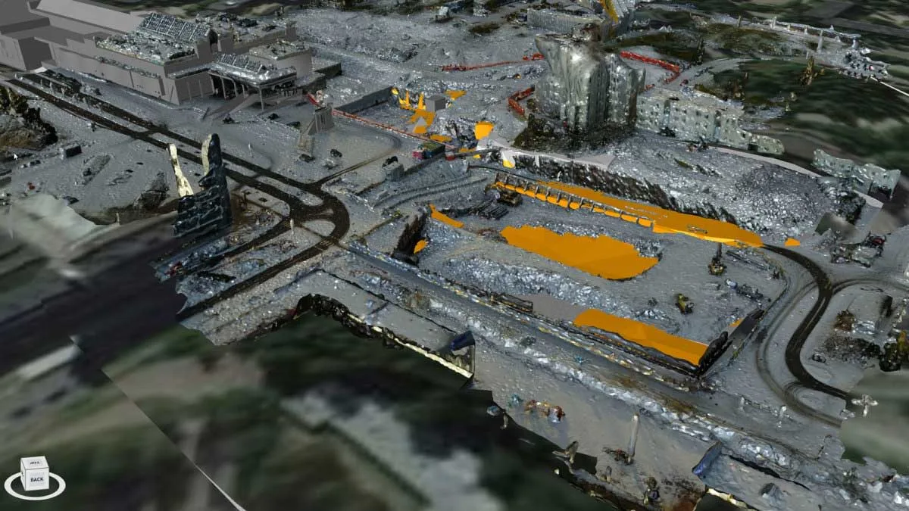
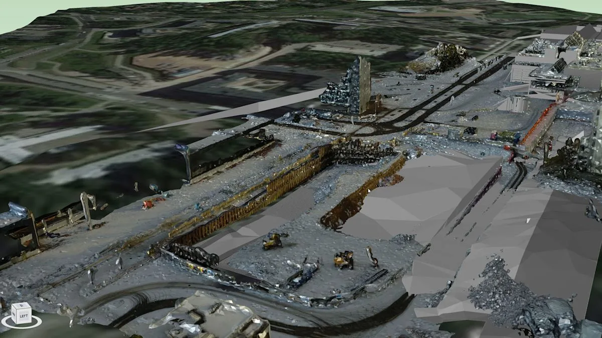

## 철거 현장의 사진과 영상, 3D 기록으로 이어지려면

철거 현장은 하루만 지나도 촬영 대상의 형태가 달라집니다. 서로 다른 위치에서 찍은 사진과 짧은 영상이 남아 있어도, 그 자료가 곧바로 치수를 잴 수 있는 3D 도면이 되는 것은 아닙니다. **무엇을 촬영했는지뿐 아니라, 서로 겹치는 영역이 있는지와 결과를 어디까지 신뢰할 수 있는지**를 구분해야 합니다.

2026년 11월 8일 공개된 [쇼핑몰 극장 철거 기록 시연](https://www.reddit.com/r/photogrammetry/comments/1xr7ii2/reconstructing_a_mall_theater_during_demolition/)에서 게시자 AECPLATFORM은 각기 다른 위치의 영상 클립과 사진을 공통 특징점으로 연결해 **희소 점군(sparse point cloud)**을 만들었다고 설명했습니다. 아직 밀집 점군은 처리 중이라는 개인 게시물입니다. 정확도, 완성된 모델의 품질, 상업적 적용 성과는 독립적으로 확인되지 않았으며 드론 촬영 사례라는 근거도 없습니다.

출처: [u/AECPLATFORM, Reddit r/photogrammetry 원문 게시물](https://www.reddit.com/r/photogrammetry/comments/1xr7ii2/reconstructing_a_mall_theater_during_demolition/), 2026년 11월 8일. 게시 영상의 640px 미리보기 이미지를 WebP로 변환했으며 완성된 측량 성과물이 아닙니다.

## ‘형태가 보인다’와 ‘위치를 측정할 수 있다’는 다릅니다

희소 점군은 사진 사이의 대응 관계와 대략적인 구조를 확인하는 초기 결과입니다. 이 단계의 화면만 보고 철거량, 잔존 부재의 위치 또는 준공 치수를 확정해서는 안 됩니다. 촬영 시점마다 구조물이 바뀌었다면 같은 특징점으로 보이는 부분도 실제로는 다른 상태일 수 있습니다. 먼지, 단색 벽면, 가려진 구역처럼 공통 특징을 찾기 어려운 조건도 별도로 점검해야 합니다.

고객이 철거 전후 비교나 보존 기록을 원한다면 **촬영 날짜·구역·카메라 위치, 변경된 구조물의 범위, 공통 기준점 및 누락 구역**부터 구분하는 편이 유용합니다. 길이·면적을 산출할 목적이라면 확인 가능한 기준거리나 측량 기준점, 좌표계와 별도의 검증점을 정하고 결과의 오차를 확인해야 합니다. 이는 위 개인 시연에서 달성했다고 발표한 성능이 아니라, 실제 프로젝트에서 검토할 품질 기준입니다.

## 넓은 현장에는 항공 지도, 실내·가림 구역에는 지상 촬영

이러한 역할 분담의 참고 사례로, PIX4D가 **2018년 10월 24일 게시하고 2020년 6월 11일 갱신한** [핀란드 Lippulaiva 쇼핑센터 재개발 사례](https://www.pix4d.com/blog/boosting-4D-project-management-with-drone-mapping)가 있습니다. 시공사 Lehto Group과 현장 관리팀은 철거·토공 과정에서 드론으로 현장을 정기 촬영하고, 생성된 정사영상과 점군·3D 모델을 일정 계획과 비교하는 데 활용했다고 설명합니다. 원문에 소개된 주간 촬영과 회의 활용은 **해당 프로젝트의 운영 방식**이지 모든 철거 현장의 필수 주기나 국내 현장 성과를 뜻하지 않습니다.

출처: [PIX4D Blog, “Boosting 4D project management with drone mapping”](https://www.pix4d.com/blog/boosting-4D-project-management-with-drone-mapping/), 2018년 게시·2020년 갱신. PIX4D 원문 이미지를 WebP로 변환.

드론은 현장 전체의 작업 구역과 토공 진행을 같은 시야에서 반복 기록하는 데 적합합니다. 반면 실내 극장이나 지붕 아래, 장비 뒤편처럼 항공 시야가 닿지 않는 곳은 지상 사진·영상 등 별도의 취득 방식이 필요합니다. **두 사례가 하나의 현장에서 연동됐다는 뜻은 아닙니다.** 서로 다른 자료를 결합하려면 촬영 시점과 좌표 기준을 맞추고, 겹치는 구역에서 정합 품질을 확인해야 합니다.

PIX4D 사례에서는 현장 점군을 4D 일정 모델과 대조해 작업 상태를 논의했다고 설명합니다. 아래 이미지는 그 사례의 현장 3D 모델 화면이며, 위 Reddit 시연의 극장 모델이 아닙니다.

출처: [PIX4D Blog, “Boosting 4D project management with drone mapping”](https://www.pix4d.com/blog/boosting-4D-project-management-with-drone-mapping/), 2018년 게시·2020년 갱신. PIX4D 원문 이미지를 WebP로 변환.

## 고객에게 전달할 결과는 목적에 맞춰 달라집니다

현장 변화의 **시각적 이력**이 필요하다면 촬영 위치가 표시된 원본 사진·영상과 날짜별 정사영상만으로도 검토를 시작할 수 있습니다. 형상 비교가 필요하면 가림 구역을 보완한 점군·모델과 촬영 범위를 함께 전달해야 합니다. 수량·위치 판단에 쓰려면 검증점의 오차, 단위와 좌표계, 제외 구간을 명시해 해석 범위를 한정해야 합니다. 모델이 그럴듯하게 보인다는 이유만으로 검증되지 않은 부분까지 측량 자료로 취급하지 않겠습니다.

아이엠드론은 철거·리모델링 현장에서 고객이 필요한 기록의 목적부터 확인하고, **항공 촬영이 담당할 범위와 지상 촬영으로 보완할 구역**을 구분하겠습니다. 촬영 시점, 원본 자료, 위치 기준, 누락 구역과 품질 확인 결과를 함께 전달해 다음 공정에서도 다시 확인할 수 있는 현장 기록을 돕겠습니다.

## 참고한 공식 자료

- PIX4D Blog, [“Boosting 4D project management with drone mapping”](https://www.pix4d.com/blog/boosting-4D-project-management-with-drone-mapping/), 페이지 상단 2018년 10월 24일, 본문 표기 최초 게시 2018년 10월 25일·갱신 2020년 6월 11일. 핀란드 쇼핑센터 철거·재개발 현장의 드론 매핑 및 일정 비교 사례, 이미지 출처.

## 추가 참고: 독립 검증 전 시연

- u/AECPLATFORM, [“Reconstructing a mall theater during demolition from separate videos and photos—sparse cloud so far”](https://www.reddit.com/r/photogrammetry/comments/1xr7ii2/reconstructing_a_mall_theater_during_demolition/), Reddit r/photogrammetry, 2026년 11월 8일(UTC 게시). 개인 자체 시연 및 영상 미리보기 출처. 희소 점군 단계만 게시됐고 정확도·드론 사용 여부는 확인되지 않았습니다.
