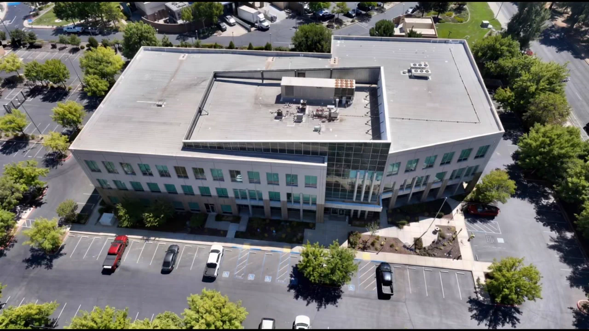
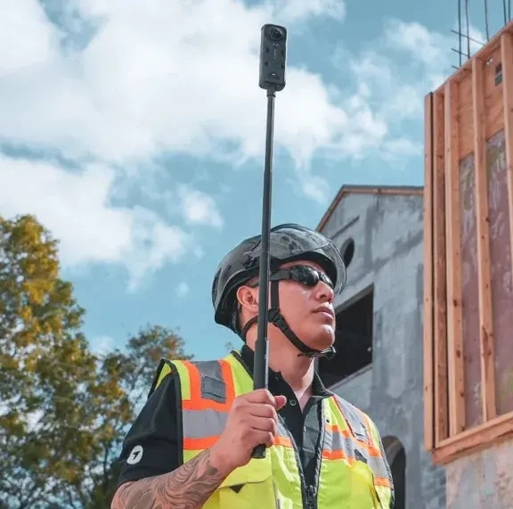

## 공정 기록의 빈 공간, 실외 드론 촬영과 실내 360 워크로 메우기

건설 현장의 항공 사진은 건물 외형, 자재 적치, 진입로와 주변 작업 구역을 한눈에 보여줍니다. 하지만 천장이 닫히기 전 설비가 어떻게 놓였는지, 계단실 내부가 어느 단계까지 진행됐는지는 위에서 찍은 사진만으로 확인하기 어렵습니다. **현장 전체의 변화와 실내 공간의 변화를 같은 기간에 기록하되, 서로 다른 촬영 방식의 역할을 구분**해야 합니다.

2026년 11월 9일(UTC), DroneDeploy는 [공식 X 게시물](https://x.com/DroneDeploy/status/2119845110099984643)에서 사무실 리모델링 과정의 여러 차례 **실내 360도 워크 기록**을 이어 약 1분 분량의 AI 타임랩스로 만든 데모를 소개했습니다. 노출된 천장과 골조에서 완성된 계단까지의 변화를 보여준다는 설명입니다. 이것은 **지상 360 촬영의 시각화 데모**이며 드론 촬영 사례, 정량적인 공기 단축 효과 또는 국내 현장 적용 실적이 아닙니다.

출처: [DroneDeploy 공식 X, 사무실 리모델링 360 워크 타임랩스 게시물](https://x.com/DroneDeploy/status/2119845110099984643), 2026년 11월 9일(UTC). 공식 게시 영상의 커버 이미지이며 특정 공정의 측량 결과 사진이 아닙니다. [원본 영상 보기](https://x.com/DroneDeploy/status/2119845110099984643).

## 같은 날짜에 찍어도, 같은 정보가 남지는 않습니다

실외에서는 정기적인 드론 촬영으로 지붕·외벽·가설시설·토공 등 전체 공정의 위치 관계를 기록할 수 있습니다. 실내에서는 360 카메라로 복도, 기계실, 계단실을 따라 이동하며 항공 시야에서 가려진 공간을 남길 수 있습니다. DroneDeploy의 [Ground 공식 제품 소개](https://www.dronedeploy.com/product/dronedeploy-ground)는 360 워크를 도면상의 위치와 날짜에 연결해 시점별 상태를 비교하고, 항공 지도와 지상 기록을 같은 프로젝트 환경에서 조회할 수 있다고 설명합니다. **이는 해당 업체의 제품 설명이지 아이엠드론의 플랫폼 기능을 뜻하지 않습니다.**

출처: [DroneDeploy, “DroneDeploy Ground: 360-Degree Site Documentation & Photo Capture Software”](https://www.dronedeploy.com/product/dronedeploy-ground), 제품 페이지(게시일 미표기). 원문 이미지를 사용했습니다.

두 기록을 함께 활용할 때는 **촬영일, 촬영 구역, 도면 버전, 실내 워크 경로**가 먼저 맞아야 합니다. 실외 항공 사진의 건물 외형과 실내 기록의 방 번호가 각각 남아 있어도, 자료를 받은 사람이 위치와 날짜를 연결하지 못하면 변경 전후를 다시 찾아보기 어렵습니다. 같은 구역을 비교하려면 이전 기록이 어느 방향에서 촬영됐는지, 가려진 부분은 없는지도 확인해야 합니다.

## 타임랩스는 설명 자료, 원본 기록은 확인 자료

공정 전후를 빠르게 이해시키는 타임랩스는 발주처 브리핑이나 이해관계자 공유에 유용할 수 있습니다. 다만 편집 영상에서 자연스럽게 이어지는 장면이 **모든 공정의 연속 촬영, 시공 품질 검증 또는 치수 검증**을 의미하지는 않습니다. 사용한 날짜별 원본, 촬영되지 않은 구역, 편집 순서를 함께 남겨야 뒤늦게 특정 시점의 상태를 확인할 수 있습니다.

실제 현장에 적용한다면 외부 작업 구역은 반복 항공 촬영 일정과 비교 지점을 정하고, 실내는 벽체 마감이나 천장 폐쇄처럼 **나중에 보이지 않게 되는 작업 전후**에 360 워크를 배치할 수 있습니다. 이후 전달물은 날짜별 항공 사진·지도, 위치가 표시된 실내 원본, 비교용 장면과 누락 구역 목록으로 구분하는 편이 분명합니다. 타임랩스 제작이나 특정 AI 기능의 도입 여부는 현장 요구사항과 도구를 확인한 뒤 결정해야 합니다.

아이엠드론은 고객의 현장 기록 목적에 맞춰 드론 촬영으로 확인할 외부 범위와 지상 촬영이 필요한 실내 구역을 구분하고, 반복 촬영 시점과 자료 인계 기준을 함께 설계하겠습니다. **보기 좋은 영상뿐 아니라 필요한 시점의 상태를 다시 찾을 수 있는 기록**이 되도록 돕겠습니다.

## 참고한 공식 자료

- DroneDeploy 공식 X, [사무실 리모델링 360 워크의 AI 타임랩스 데모](https://x.com/DroneDeploy/status/2119845110099984643), 2026년 11월 9일 17:30 UTC(한국시간 11월 10일 02:30). 실내 360 기록 데모와 영상 커버 출처.
- DroneDeploy, [“DroneDeploy Ground: 360-Degree Site Documentation & Photo Capture Software”](https://www.dronedeploy.com/product/dronedeploy-ground), 제품 페이지(게시일 미표기, 2026년 11월 10일 확인). 360 워크의 도면·날짜 연결과 항공/지상 자료 조회 설명 및 현장 이미지 출처.
