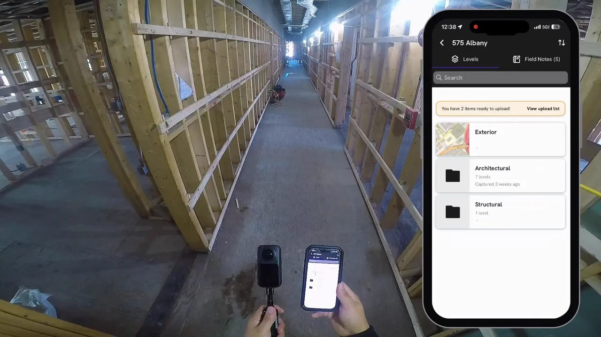

## 360 워크로 한 층을 17분 만에 기록했다면, 무엇까지 남았을까요?

건설 현장에서 “한 층을 촬영했다”는 말은 공정 관리에 필요한 모든 구역을 확인했다는 뜻과 다릅니다. 발주처가 다시 찾아볼 수 있는 기록이 되려면 **촬영에 걸린 시간뿐 아니라 도면상의 위치, 촬영 시점, 가려진 구역**도 함께 확인해야 합니다.

DroneDeploy는 **2026년 11월 10일 15:40(UTC)** [공식 X 게시물](https://x.com/DroneDeploy/status/2120179691034419499)에서 360 워크로 **10,000제곱피트 규모의 한 층을 17분 미만에 촬영하고 각 사진을 평면도에 연결했다**고 소개했습니다. 이는 업체가 게시한 시연 설명입니다. 현장의 실제 동선, 촬영 지점 수, 데이터 처리 및 검수 시간, 사진의 판독 품질은 게시문만으로 확인할 수 없습니다. 다른 현장에서도 같은 시간에 같은 품질을 낼 수 있다는 보장은 아닙니다.

출처: [DroneDeploy 공식 X, 360 워크 한 층 촬영 시연](https://x.com/DroneDeploy/status/2120179691034419499), 2026년 11월 10일(UTC). 공식 영상의 대표 이미지이며 측량 정확도나 촬영 범위를 증명하는 결과물은 아닙니다.

## 빠른 촬영과 찾을 수 있는 기록은 별개의 기준입니다

[DroneDeploy Ground 제품 페이지](https://www.dronedeploy.com/product/dronedeploy-ground)는 360 카메라와 모바일 앱으로 촬영한 사진을 위치·날짜별로 도면에 표시하고, 같은 지점의 서로 다른 시점을 비교하는 기능을 설명합니다. 이 기능은 **DroneDeploy의 제품 설명**이며 아이엠드론이 같은 소프트웨어 기능을 제공한다는 의미는 아닙니다.

현장에서 속도를 비교할 때는 사람이 워크 경로를 이동한 시간만 볼 수 없습니다. 작업 구역 출입, 사진과 도면의 위치 연결, 업로드, 누락 여부 확인, 고객이 열람할 자료 정리까지 구분해야 합니다. 특히 벽체와 천장이 닫히면 다시 볼 수 없는 설비 구간은 촬영이 빨랐는지보다 **필요한 위치에서 판독 가능한 이미지가 남았는지**가 중요합니다.

## 현장별로 먼저 정할 세 가지

- **범위:** 한 층의 전체 면적인지, 접근 가능한 복도와 주요 실만 촬영했는지 구분합니다. 출입 제한·차폐 구역은 누락 목록으로 남깁니다.
- **위치:** 촬영에 사용한 도면의 버전과 층·구역 명칭을 고정합니다. 사진이 도면의 어느 지점에 연결됐는지 표본을 열어 확인합니다.
- **시간:** 순수 워크 시간과 준비·전송·검수 시간을 따로 기록하고, 벽체 마감 전처럼 다시 촬영하기 어려운 공정 시점을 지정합니다.

이 기준은 업체 시연의 검증 결과가 아니라, 고객 현장에서 반복 가능한 기록 범위를 정하기 위한 실무 항목입니다. 360 이미지는 도면에 연결됐더라도 자동으로 치수 검증이나 시공 품질 판정을 제공하지 않습니다.

지난 [실외 드론 촬영과 실내 360 워크의 역할](https://imdrone.site/blog/2026-11-10-construction-aerial-360-progress-timelapse)에서 살펴본 것처럼, 항공 사진은 외부 공정과 동선을 보여주고 실내 워크는 항공 시야에서 가려진 공간을 채웁니다. 이번 시연이 던지는 질문은 “몇 분 만에 촬영할 수 있나”를 넘어 **같은 날짜의 외부·실내 기록을 고객이 필요한 위치에서 다시 확인할 수 있나**입니다.

아이엠드론은 고객 현장의 촬영 목적에 맞춰 드론 항공 촬영 구역과 지상 기록이 필요한 구역을 나누고, 촬영 시점과 자료 인계 기준을 함께 설계하겠습니다. 특정 현장의 소요시간이나 적용 도구는 실제 접근 조건과 자료 요구사항을 확인한 뒤 판단하겠습니다.

## 참고한 공식 자료

- DroneDeploy 공식 X, [“In just under 17 minutes, a 360 walk captured a 10,000-square-foot floor…”](https://x.com/DroneDeploy/status/2120179691034419499), 2026년 11월 10일 15:40 UTC(한국시간 11월 11일 00:40). 촬영 시간·면적·도면 연결에 대한 업체 게시 설명 및 영상 대표 이미지 출처.
- DroneDeploy, [“DroneDeploy Ground: 360-Degree Site Documentation & Photo Capture Software”](https://www.dronedeploy.com/product/dronedeploy-ground), 제품 소개 페이지(게시일 미표기, 2026년 11월 11일 확인). 360 워크의 도면 위치·날짜 연결 기능 참고.
