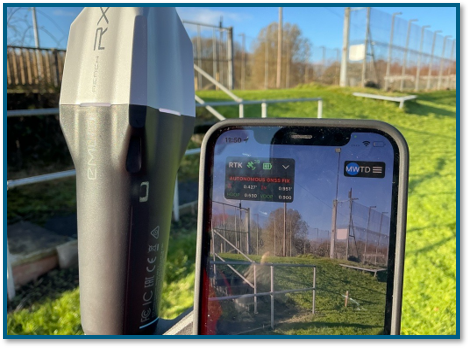
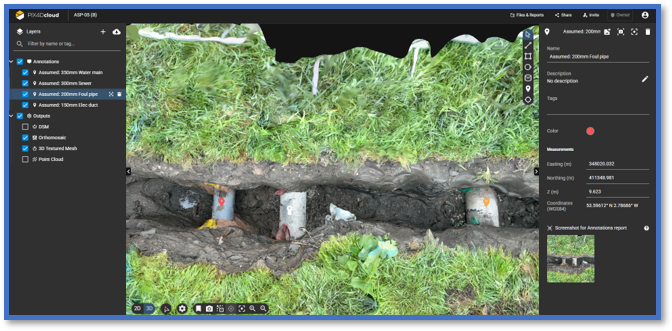

## 14개 현장의 관로 기록을 같은 방식으로 남기려면

상수도·수처리 시설 공사가 끝나고 관로를 되메우면, 다음 점검 때는 매설 위치와 접속 상태를 눈으로 확인하기 어렵습니다. 한 번의 정밀 촬영도 중요하지만, 현장이 여러 곳이라면 **언제 무엇을 기록하고 어떤 이름으로 전달할지**가 같아야 기록을 다시 쓸 수 있습니다.

[PIX4D가 2026년 11월 10일 공개한 MWH Treatment 사례](https://www.pix4d.com/blog/mwh-treatment-water-infrastructure-asset-capture-pix4d/)는 영국 수자원 시설 시공·유지관리 업체가 스마트폰 기반 PIX4Dcatch와 Emlid RTK 장치를 이용해 개착 관로와 시굴부를 지상에서 기록한 사례입니다. 기사에 따르면 장비 12대를 도입했고, 도입 초기 기준으로 활성 현장 14곳에서 공정별 스캔을 진행하며 엔지니어링·시공·현장 직무 사용자 73명이 참여합니다. 2027년에는 적용 범위를 넓힐 계획이라고 설명합니다. **드론으로 지중 관로를 촬영한 실적은 아닙니다.**

출처: [PIX4D, MWH Treatment 수자원 시설 기록 사례](https://www.pix4d.com/blog/mwh-treatment-water-infrastructure-asset-capture-pix4d/), 2026년 11월 10일. 원문 본문 사진.

## 1cm 시험 결과보다 먼저 확인할 것: 기록의 적용 범위

PIX4D는 기존 수기 도면 표기의 위치 오차가 ±1m 수준인 데 비해, **현장 시험에서는 ±1cm** 결과를 확인했다고 소개합니다. 이는 공급사 고객 사례의 시험 조건에서 나온 수치이며, 모든 매설물과 모든 현장에서 동일한 정확도를 보장하지 않습니다. 또 원문에 나온 기록 시간과 관련 비용의 **약 90% 절감은 향후 가능성에 대한 전망**이지, 14개 현장의 확정 절감 실적이 아닙니다.

고객에게 필요한 것은 숫자만이 아닙니다. 기준 좌표계와 RTK 보정 상태, 촬영 가능한 관로 면, 가려진 이음부, 검측 시점이 누락되면 정밀해 보이는 모델도 다음 정비에서 혼선을 줄 수 있습니다. **스캔 영상·좌표가 어떤 관로와 어느 공정 단계에 해당하는지**를 함께 확인해야 합니다.

## 다현장 운영에서 중요한 것은 같은 인계 규칙입니다

원문에서 MWH Treatment는 현장별로 방식이 달라지는 것을 피하려고 중앙화된 운영 방식을 택했다고 설명합니다. 특히 초기 시험에서 마커를 이용해 설비 정보를 남기고, 데이터를 일정한 형식으로 입력하면 CAD 담당자의 수작업이 줄어든다는 현장팀 의견을 전합니다. 따라서 여러 현장에 적용할 때는 아래의 인계 항목을 먼저 합의하는 편이 실용적입니다. 이는 PIX4D의 검증 수치가 아니라 고객 프로젝트를 설계할 때 확인할 기준입니다.

- **시점과 상태:** 굴착 전·관로 설치 후·되메우기 전의 구간을 분리하고, 발견 상태(as-found)와 시공 상태(as-laid)를 혼동하지 않습니다.
- **위치와 자산:** 현장명, 구간 번호, 관로·밸브 식별자, 좌표계, RTK 품질 확인 내역을 같은 기록 묶음에 둡니다.
- **검수와 인계:** 사진에서 보이지 않는 부분을 별도로 표시하고, 3D 결과와 도면·자산 목록의 대응 관계를 표본 확인합니다. 공사·시설관리 담당자가 다음 작업 때 찾을 수 있는 파일명과 접근 권한도 정합니다.

출처: [PIX4D, MWH Treatment 수자원 시설 기록 사례](https://www.pix4d.com/blog/mwh-treatment-water-infrastructure-asset-capture-pix4d/), 2026년 11월 10일. 원문 본문 이미지.

## 항공 현장 기록과 지상 관로 기록은 역할이 다릅니다

드론 항공 촬영은 공사 구역 전체의 변화, 토공·진입로·주변 시설과의 관계를 반복해서 보여줄 수 있습니다. 반면 **노출된 배관과 이음부의 위치·형상 기록은 되메우기 전에 지상에서** 확보해야 합니다. 항공 정사영상만으로 땅속 관로의 정확한 좌표를 읽을 수는 없습니다. 지난 [관로 준공기록과 유지관리 인계에 관한 글](https://imdrone.site/blog/2026-10-31-buried-utility-records-maintenance-handoff)에서 다룬 ‘무엇을 인계할까’라는 질문에, 이번 MWH 사례는 ‘여러 현장에서 같은 방식으로 어떻게 수집할까’라는 운영 측면을 더합니다.

아이엠드론은 고객의 공정과 점검 목적에 맞춰 **드론 항공 모니터링 범위와 개착부 지상 기록 범위**를 구분하고, 현장·날짜·자산번호로 자료를 찾아볼 수 있는 인계 구조를 함께 설계하겠습니다. 지상 RTK 기록의 적용 장비, 좌표 정확도와 국내 측량·준공 기준 적합성은 프로젝트별로 별도 확인이 필요합니다.

## 참고한 공식 자료

- PIX4D, [“Digitizing water infrastructure with PIX4Dcatch”](https://www.pix4d.com/blog/mwh-treatment-water-infrastructure-asset-capture-pix4d/), 2026년 11월 10일. MWH Treatment의 장비·현장·사용자 규모, 현장 시험 정확도, 절감 전망 및 본문 이미지 출처.

