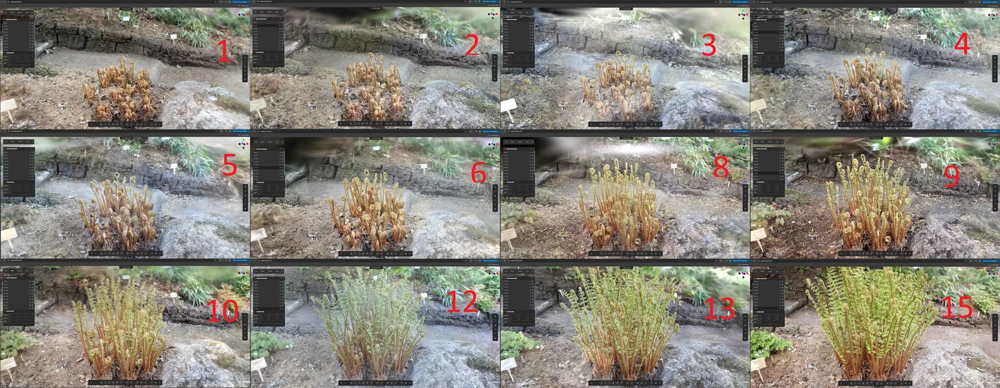
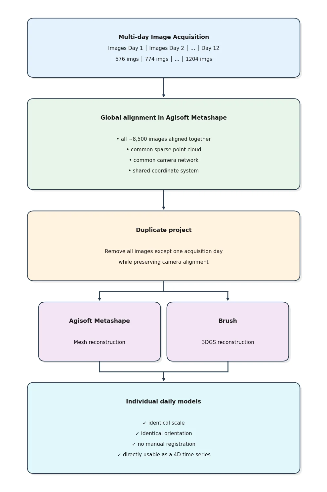

## 식물이 자라는 모습을 3D로 남긴다면, 무엇을 비교할 수 있을까요?

녹지와 식물은 한 번 촬영한 지도로 설명하기 어렵습니다. 잎이 펴지고 가지가 자라는 동안 형상이 계속 바뀌기 때문입니다. 같은 대상을 여러 날짜에 기록하려면 보기 좋은 3D 영상만큼이나 **촬영일마다 공간 기준을 일치시키는 일**이 중요합니다.

2026년 11월 12일 [Pensoft Science Blog가 소개한 타르투대 연구](https://blog.pensoft.net/2026/11/12/digital-twins-for-plants-how-ordinary-cameras-are-helping-preserve-living-collections/)는 사진측량과 3D Gaussian Splatting(3DGS)을 함께 사용해 식물의 형상과 시간에 따른 변화를 기록했습니다. 연구진은 식물원의 야외 고사리를 15일 가운데 12일에 걸쳐 약 8,500장으로 촬영했고, 열대 온실은 14개 구역에서 약 2만 장의 사진으로 탐색형 공간을 만들었습니다. **고사리와 온실의 이 수치를 드론 항공촬영 실적으로 해석해서는 안 됩니다.** 연구에서 드론은 별도의 나무 촬영 사례에 사용됐습니다.

출처: [Pensoft Science Blog, 식물 디지털 트윈 연구 소개](https://blog.pensoft.net/2026/11/12/digital-twins-for-plants-how-ordinary-cameras-are-helping-preserve-living-collections/), 2026년 11월 12일. 원문 이미지 제공·크레딧: Toivo Ylinampa·Urmas Kõljalg, 2026. 원문 정지 이미지를 웹용으로 변환·축소했습니다.

## 측정할 3D와 살펴볼 3D는 목적이 다릅니다

사진측량은 겹치는 사진을 정합해 형상과 크기를 추정하므로, 기준과 품질이 확보되면 치수 비교에 활용할 수 있습니다. 반면 3DGS는 잎과 꽃처럼 얇고 복잡한 구조를 시각적으로 탐색하는 데 유용합니다. 연구 소개는 꽃 한 부분의 사진측량 모델에서 약 13mm, 캘리퍼스에서 13.2mm를 기록한 예를 들지만, **이 한 번의 비교가 모든 식생·장비·현장의 측정 정확도를 보장하지는 않습니다.** 온실의 구역별 모델도 수작업으로 이어 붙여 정밀 측량보다 가상 탐색에 적합했다고 설명합니다.

출처: [Pensoft Science Blog, 식물 디지털 트윈 연구 소개](https://blog.pensoft.net/2026/11/12/digital-twins-for-plants-how-ordinary-cameras-are-helping-preserve-living-collections/), 2026년 11월 12일. 원문 ‘4D workflow’ 도식·크레딧: Toivo Ylinampa·Urmas Kõljalg, 2026. 원문 이미지를 웹용으로 변환했습니다.

## 날짜가 달라도 같은 위치에서 비교하려면

연구진은 고사리 자체가 바뀌어도 주변의 변하지 않는 배경 특징을 이용해 여러 날짜의 사진을 한 프로젝트에서 정합했습니다. 그 결과 각 날짜의 모델이 같은 축척과 방향을 공유하도록 했습니다. 고객 현장에서도 **대상물 밖의 안정적인 기준, 동일한 촬영 범위, 날짜별 원본과 처리 이력**을 함께 남겨야 변화가 생육 때문인지 촬영·정합 차이 때문인지 구분할 수 있습니다. 이는 해당 연구를 환경·녹지 관측에 적용할 때 제안하는 검토 기준이지, 연구가 모든 현장에서 검증한 운영 절차는 아닙니다.

바람은 특히 중요합니다. 원문은 잎이 조금만 움직여도 재구성 품질이 떨어졌다고 밝힙니다. 고사리 사진 정합에도 약 7시간과 48GB 메모리가 들었다고 설명합니다. 반복 관측을 기획할 때는 촬영 시간만이 아니라 바람 조건, 데이터 양, 처리 자원, 산출물 검수까지 범위에 넣어야 합니다.

## 항공 관측과 근거리 식물 기록을 나눠 설계합니다

수목 분포나 녹지 구역의 전체 변화는 항공 촬영으로 살펴볼 수 있지만, 꽃·잎의 미세 형상이나 온실 내부는 지상·근거리 촬영의 몫입니다. 이 연구는 **작물 수확량이나 NDVI의 정확도·효율을 검증한 사례가 아닙니다.** 아이엠드론은 고객의 조사 목적에 맞춰 드론으로 살필 범위와 지상에서 기록할 대상을 구분하고, 서로 다른 날짜의 자료를 비교할 수 있도록 촬영 기준과 자료 인계 방식을 설계하겠습니다. 실제 측정 정확도와 현장 적용 가능성은 대상과 촬영 조건에 따라 별도로 확인해야 합니다.

## 참고한 공식 자료

- Pensoft Science Blog, [“Digital Twins for Plants: How Ordinary Cameras Are Helping Preserve Living Collections”](https://blog.pensoft.net/2026/11/12/digital-twins-for-plants-how-ordinary-cameras-are-helping-preserve-living-collections/), 2026년 11월 12일. 연구 소개, 촬영 규모, 방법의 한계 및 본문 이미지 출처.
- Toivo Ylinampa·Urmas Kõljalg, [“Photogrammetry and 3D Gaussian Splatting for 4D plant growth capture and greenhouse digital twins”](https://doi.org/10.3897/BDJ.14.e191083), *Biodiversity Data Journal* 14, e191083, 2026년 10월 23일. 원 연구 논문.
