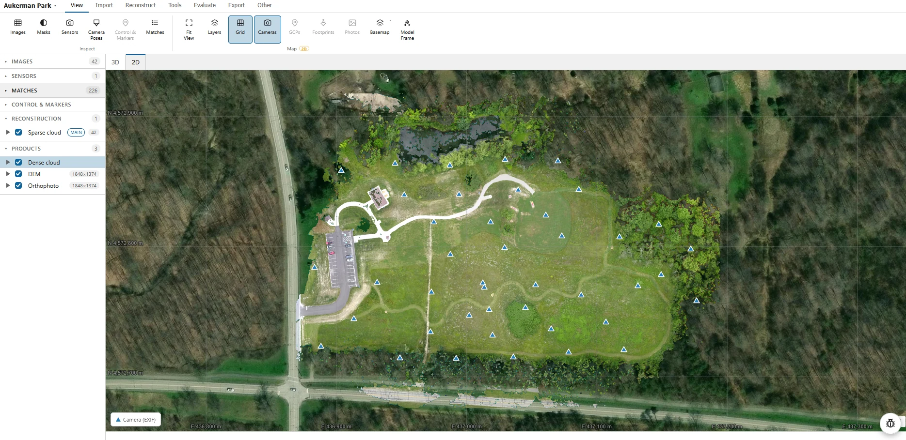

## 현장 사진을 외부 서버에 올리기 어렵다면, 정사영상은 어떻게 만들까요?

공사 현장의 배치도, 시설물 외관, 보안 구역의 촬영 사진은 처리 위치부터 검토해야 합니다. 외부 클라우드 업로드가 어려운 고객에게는 **사진이 어디에서 처리되고, 결과물을 어떻게 검수해 인계하는지**가 소프트웨어 선택의 기준입니다.

2026년 11월 14일 확인한 [WebSfM 개발자 공식 저장소](https://github.com/fdahle/websfm)는 설치 없이 브라우저 안에서 사진을 처리해 점군·표고모델(DEM)·정사영상을 만드는 베타 도구를 소개합니다. 저장소는 2026년 6월 생성됐으며, 11월 13일 국내 시간 기준 [개발자가 포토그래메트리 커뮤니티에 소개](https://www.reddit.com/r/photogrammetry/comments/1xuri77/websfm_structurefrommotion_in_the_browser/)했습니다. 이번 소개를 제품의 최초 출시나 검증 완료로 해석하지는 않습니다.

## ‘로컬 처리’와 ‘검증된 보안 환경’은 다릅니다

개발자 설명에 따르면 사진 연산은 브라우저의 로컬 작업자와 WebAssembly에서 진행되며, 프로젝트는 브라우저 저장 공간에 보관됩니다. 이미지 업로드를 전제로 하는 클라우드 처리와는 다른 구성입니다. 다만 **사진이 서버로 전송되지 않는다는 제품 설명만으로 보안 적합성이 확정되지는 않습니다.** 앱 코드와 모델 파일을 처음 받아오는 경로, 브라우저 저장 위치·삭제 방식, 기기 반출 통제, 조직의 네트워크 정책은 별도로 확인해야 합니다. WebSfM은 일부 학습 기반 기능의 모델 가중치를 최초 사용 시 다운로드한다고 명시합니다. 완전한 오프라인 사용이나 기관 내부망 적합성은 이 글에서 검증하지 않았습니다.

출처: [WebSfM 개발자 fdahle, 공식 저장소 README의 정사영상 화면](https://github.com/fdahle/websfm), 2026년 11월 14일 확인. 예제 항공 사진: OpenDroneMap Aukerman 데이터(CC0 1.0); 화면 배경 지도: Esri World Imagery(Esri, Vantor, Earthstar Geographics 및 GIS User Community). 원본 이미지를 웹사이트에 재게시했습니다.

## 결과물 형식보다 먼저 확인할 것은 위치 정확도입니다

WebSfM은 지상기준점(GCP), 좌표계 설정, LAS·LAZ 점군 및 GeoTIFF 등의 입출력을 소개합니다. 위 화면은 정사영상 예제일 뿐 고객 현장에서의 위치 정확도를 증명하지 않습니다. 개발자 [벤치마크 문서](https://github.com/fdahle/websfm/blob/main/docs/BENCHMARKS.md)에는 다른 도구 및 기준 데이터와의 시험이 공개되어 있지만, **한 개발자의 시험 조건에서 얻은 결과**이며 고객 현장·PC·브라우저에서 같은 결과가 나온다는 보장은 아닙니다. 문서에는 일부 산출물 크기와 처리 조건이 비교 도구와 다른 점도 명시되어 있습니다.

현장 도입을 결정할 때는 같은 원본 사진으로 기존 처리 방식과 함께 시험하고, 보정에 사용하지 않은 **독립 체크포인트의 수평·수직 오차**, 정사영상의 해상도·누락 구역, 좌표계와 높이 기준, GeoTIFF·점군의 GIS 호환성을 비교해야 합니다. 수백 장의 고해상도 사진이라면 브라우저 메모리 한계와 처리 실패 시 복구 가능성도 확인 대상입니다. 이는 WebSfM에서 이미 검증됐다는 결과가 아니라, 고객 자료를 인계하기 전에 필요한 평가 항목입니다.

## 적용은 제한된 시험 구역부터

제조사 README는 WebSfM을 0.x **베타**로 명시하고, 일부 대화형 GCP 표시·지오리퍼런싱 작업과 외부 도구에서의 메시·3D Tiles 사용 등은 실제 데이터로 끝까지 검증되지 않았다고 밝힙니다. 따라서 인허가 도면이나 확정 측량 성과를 곧바로 이 도구의 결과물로 대체해서는 안 됩니다.

아이엠드론은 사진 반출 제약이 있는 현장에서 촬영 범위와 보안 조건을 먼저 확인하고, 필요한 경우 로컬 처리 방식의 시험 범위와 기준점·체크포인트 검수 조건을 고객과 함께 설계하겠습니다. 검증 결과가 요구 정확도와 자료 관리 기준에 미치지 못하면, 적합한 기존 처리 체계로 전환하는 판단까지 포함합니다.

## 참고한 공식 자료

- fdahle, [WebSfM 공식 GitHub README: “Structure-from-Motion in your browser”](https://github.com/fdahle/websfm), 2026년 11월 14일 확인. 기능, 로컬 처리 설명, 베타 상태, 예제 사진·이미지 및 배경 지도 출처.
- fdahle, [“WebSfM — benchmarks”](https://github.com/fdahle/websfm/blob/main/docs/BENCHMARKS.md), 2026년 11월 14일 확인. 개발자 자체 시험 환경·비교 조건 및 한계.
- fdahle, [r/photogrammetry의 WebSfM 개발자 소개](https://www.reddit.com/r/photogrammetry/comments/1xuri77/websfm_structurefrommotion_in_the_browser/), 2026년 11월 12일 UTC 게시(한국 시간 11월 13일). 소개 시점 참고.
