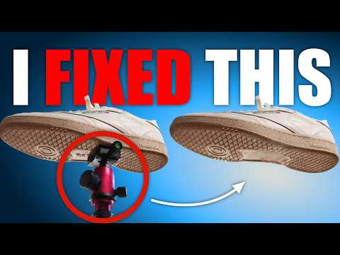

## 3D 현장 모델의 빈 곳을 메워도 될까요? 시각화와 점검 증거를 나누는 기준

드론으로 촬영한 시설물을 3D로 보여줄 때, 가려진 구역이나 재구성 과정에서 생긴 빈 곳이 눈에 띌 수 있습니다. 고객 설명용 화면이라면 보기 좋게 다듬고 싶지만, 같은 화면을 **균열·부식 확인이나 치수 판단의 근거**로 쓴다면 이야기가 달라집니다. 관측되지 않은 부분을 자연스럽게 채운다고 해서 그 부분의 실제 상태를 확인한 것은 아니기 때문입니다.

2026년 11월 13일 공개된 [Nicolas Drum의 Gaussian Splat 편집 시연 영상](https://www.youtube.com/watch?v=qwjmxt8kfl0)은 이 구분을 생각하게 합니다. 제작자는 스캔한 신발과 오두막 예시에서 빈 영역 메우기, 주변 데이터를 복사하는 방식과 복제 스탬프 등을 실험합니다. **개인 개발자의 시연이며 산업시설 점검 성능이나 정식 도입 가능성을 입증한 자료는 아닙니다.**

출처: [Nicolas Drum, “I Built Photoshop for Gaussian Splats (in 8 days)” 영상](https://www.youtube.com/watch?v=qwjmxt8kfl0), YouTube 공식 영상 썸네일(YouTube oEmbed 제공). 2026년 11월 15일 확인. 개인 시연 화면이며 산업시설 실측 자료가 아닙니다.

## 화면의 빈 곳을 채우는 일과 현장을 다시 확인하는 일

영상에서 제작자는 주변의 색과 구조를 가져와 빈 곳을 메우거나, 다른 위치를 복제해 붙이는 방법을 설명합니다. 신발 밑창처럼 반복되는 패턴은 가까이 보면 어긋날 수 있고, 구조와 높이를 자연스럽게 이어 붙이기도 쉽지 않다고 직접 말합니다. 일부 예시에서 시각적으로 그럴듯해 보이더라도 **편집으로 생성한 표면은 촬영 당시 카메라가 관측한 표면이 아닙니다.** 영상의 처리 속도나 화면 품질도 제작자의 장비·예시에서 보여 준 결과일 뿐, 현장 데이터에서 재현된 수치가 아닙니다.

시설물의 가려진 면이 점검 대상이라면 필요한 조치는 보정 브러시가 아니라 **추가 촬영 경로 확보, 지상 사진 보완, 접근 가능 범위와 미관측 구역 표시**입니다. 다시 촬영할 수 없는 곳은 ‘확인되지 않음’으로 남겨야 합니다. 결함이 있을지 모르는 영역을 채워 넣고 정상 표면처럼 전달하면 점검 판단이 왜곡될 수 있습니다.

## 고객이 받는 3D 결과물은 목적에 따라 구분해야 합니다

- **원본 기록:** 촬영 사진·영상, 촬영 시각과 위치, 처리에 사용한 입력 자료를 보존합니다. 현장 상태를 나중에 재확인할 출발점입니다.
- **검토·측정용 산출물:** 점군, 정사영상, 좌표가 부여된 모델 등은 사용한 기준점과 품질 검수 결과를 함께 확인합니다. 보이지 않는 영역은 추정으로 감추지 않습니다.
- **설명·홍보용 시각화본:** 보기 편하게 화면을 다듬을 수는 있지만, 메움·오브젝트 제거 위치와 방식, 원본과의 차이를 표시하고 **점검·측량의 증거 자료로 혼용하지 않습니다.**

[PIX4D가 2026년 5월 11일 소개한 Gaussian Splatting 기반 재구성](https://www.pix4d.com/blog/gaussian-splatting-pix4dmatic/)은 정합된 데이터에서 점군·정사영상과 3D 표현을 만드는 제품 워크플로에 관한 자료입니다. 이번 개인 시연의 **관측되지 않은 영역을 편집으로 메우는 행위**와는 구분해야 합니다. 어느 방식이든 화면이 매끄러워 보이는지만으로 결함 유무나 측정 정확도가 확정되지는 않습니다.

아이엠드론은 현장 3D 자료를 제공할 때 고객의 사용 목적을 먼저 확인하고, 촬영 원본과 검토용 산출물, 설명용 화면의 역할을 분리하겠습니다. 점검 범위 밖이거나 재구성에 실패한 구역은 보정된 화면으로 덮지 않고, 추가 촬영 또는 미확인 구역으로 명확히 안내하겠습니다.

## 참고한 공식 자료

- Nicolas Drum, [“I Built Photoshop for Gaussian Splats (in 8 days)”](https://www.youtube.com/watch?v=qwjmxt8kfl0), 제작자 YouTube 시연 영상, 2026년 11월 13일 공개(수집 자료 기준). 메움·복제 방식 및 예제의 한계. 영상 썸네일은 [YouTube oEmbed](https://www.youtube.com/oembed?url=https%3A%2F%2Fwww.youtube.com%2Fwatch%3Fv%3Dqwjmxt8kfl0&format=json)에서 확인.
- PIX4D Blog, [“Closing the loop: Gaussian splatting comes to PIX4Dmatic”](https://www.pix4d.com/blog/gaussian-splatting-pix4dmatic/), 2026년 5월 11일. 사진측량 기반 재구성 및 점군·정사영상 워크플로 참고(편집 도구 검증 자료는 아님).
