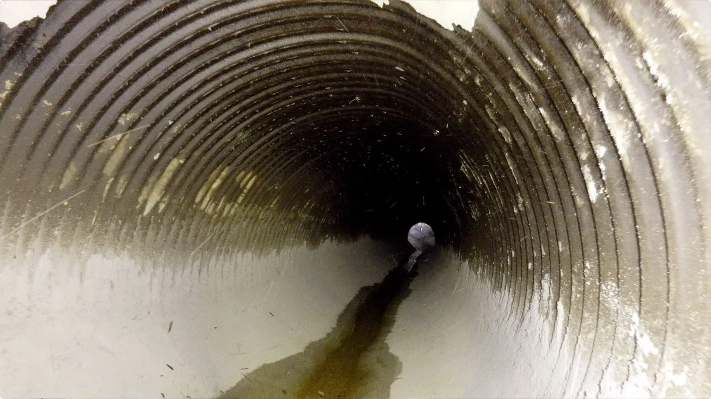
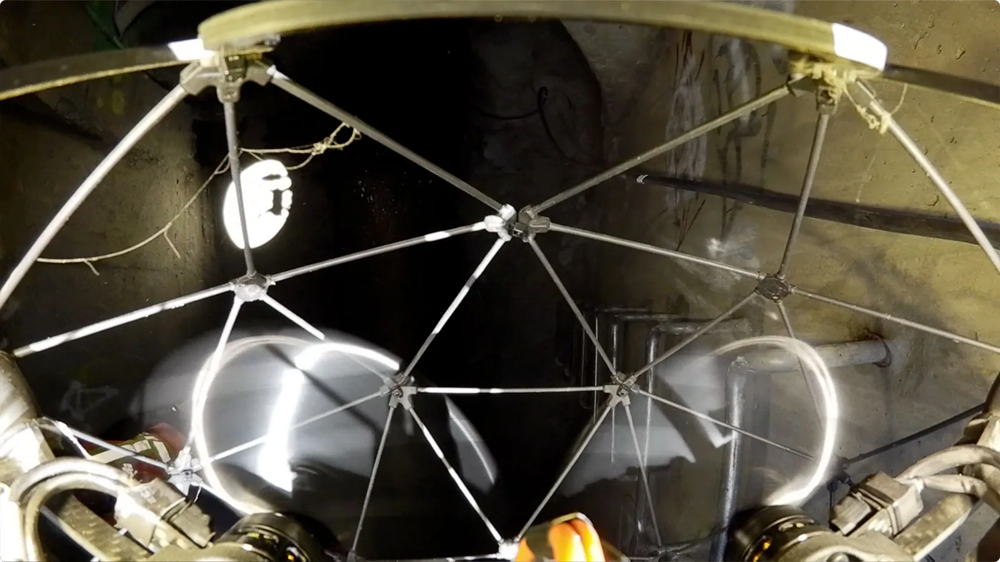

## 배수 암거가 막혔는지, 사람 없이 내부 상태를 확인할 수 있을까요?

도로 아래를 지나는 배수 암거는 평소 눈에 잘 띄지 않습니다. 그러나 내부 퇴적물이나 막힘, 벽면 손상 상태를 확인하지 못하면 유지관리 판단에 필요한 근거도 부족해집니다. 사람이 들어가기 어렵거나 지상 주행 장비가 진입하지 못하는 구간이라면 **접근 방법과 기록 방법을 함께** 정해야 합니다.

[PIX4D가 2021년 11월 24일 공개한 Flyability 사례](https://www.pix4d.com/blog/inspecting-underground-culvert)는 미국의 지하 배수 암거를 충돌 방지 케이지가 있는 Elios 2 드론으로 촬영하고, PIX4Dmapper로 내부 3D 모델을 제작한 현장 기록입니다. **2026년의 신규 장비 발표나 국내 적용 실적이 아닌 2021년 해외 사례**로, 접근이 어려운 시설의 점검 자료를 어떻게 확보했는지 살펴볼 만합니다.

출처: [PIX4D, Underground photogrammetry: surveying for public works](https://www.pix4d.com/blog/inspecting-underground-culvert), 2021년 11월 24일. 원문 본문 사진.

## 주행 장비가 못 들어가는 구간, 비행만 하면 끝날까요?

PIX4D에 따르면 해당 암거는 경사가 가팔라 기존 크롤러로 조사하기 어려웠습니다. 현장팀은 먼저 **물·장애물·조종 신호 상태를 살피는 예비 비행**을 했고, 이어 수동 비행으로 내부 사진을 확보했습니다. 기체 보호 케이지가 카메라 시야를 가리지 않도록 확인한 것도 모델 품질과 관련된 작업이었습니다. 원문은 암거 길이를 프로젝트 표에서 52m, 본문에서 약 50m로 표기하므로 이를 정밀한 길이 검측 결과로 인용하지 않습니다.

원문 프로젝트 정보에는 **광각 4K 이미지 530장**과 기체 조명 **1만 루멘**이 기재돼 있습니다. 이는 해당 사례의 장비·촬영 조건이지, 어두운 모든 암거에서 같은 장비만 쓰면 3D 복원이 된다는 뜻은 아닙니다. 물의 반사, 반복되는 콘크리트 무늬, 부유물, 곡선부의 가려짐은 현장별 촬영 범위와 모델 완성도를 따로 확인해야 할 이유입니다.

출처: [PIX4D, Underground photogrammetry: surveying for public works](https://www.pix4d.com/blog/inspecting-underground-culvert), 2021년 11월 24일. 원문 본문 이미지.

## 고객에게 필요한 결과물은 ‘3D가 있다’에서 한 단계 더 나아갑니다

Flyability 팀은 촬영 이미지의 방향과 축척을 반영해 3D 모델을 만들고, PIX4D 설명에 따르면 점검 후 **48시간 이내**에 고객에게 전달했습니다. 이 납기와 촬영 매수는 해당 프로젝트의 기록이며 국내 현장의 보장 성능으로 볼 수 없습니다. 원문도 모델의 절대 좌표 정확도나 결함 탐지율을 수치로 제시하지 않습니다.

시설물 유지관리 자료로 쓰려면 촬영 구간의 **시작·끝 위치**, 막힘이나 손상 의심 위치를 확인할 수 있는 기준, 사진 원본과 3D 결과의 연결, 촬영하지 못한 구간을 함께 남겨야 합니다. 화면에서 보이는 변색만으로 균열 깊이나 구조 안전성을 확정하지 않고, 필요하면 근접 확인·별도 계측과 연결해야 합니다. 이는 원문에 제시된 성능 수치가 아니라 실제 발주·검수 시 합의할 항목입니다.

아이엠드론은 고객의 시설 조건에 맞춰 **지상 항공 촬영으로 확인할 유역·진입로와 내부에서 별도로 확인할 암거 구간**을 구분하고, 접근성·조명·통신·위치 기준과 자료 인계 범위를 검토하도록 돕겠습니다. 일반 야외용 드론이 이 사례의 충돌 방지형 실내 기체를 대체한다고 가정하지 않으며, 밀폐공간 진입 및 비행 가능 여부와 현장 안전 절차는 별도 확인이 필요합니다.

## 참고한 공식 자료

- PIX4D, [“Underground photogrammetry: surveying for public works”](https://www.pix4d.com/blog/inspecting-underground-culvert), 2021년 11월 24일. Flyability의 Elios 2 암거 점검 사례, 촬영 조건·처리 방식·전달 시점 및 본문 이미지 출처.
