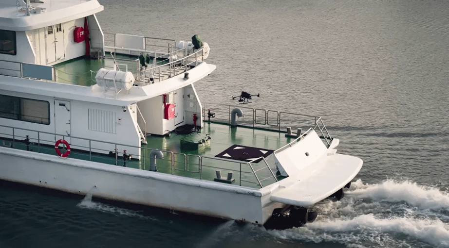
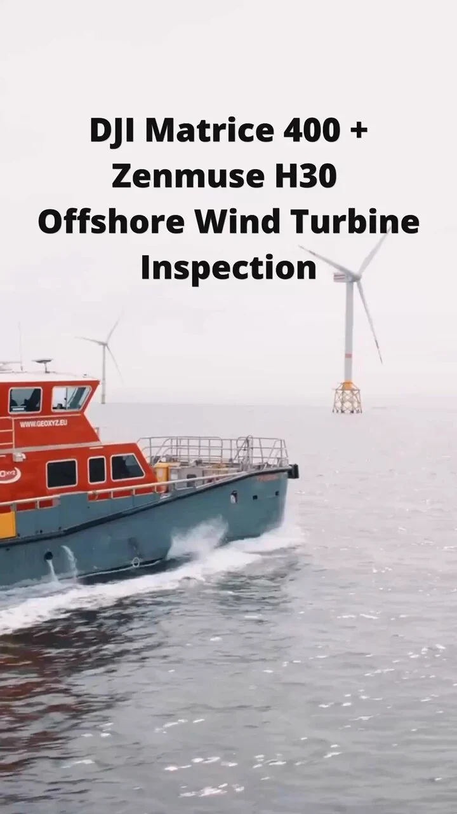

## 해상풍력 드론 점검, 촬영보다 먼저 확인할 ‘선박 복귀’ 조건

해상풍력 설비를 드론으로 살피려면 카메라가 어디까지 보이는지만으로 운용 계획을 세울 수 없습니다. 점검 구역까지의 이동, 선박 갑판에서의 이륙, 촬영 뒤 **움직이는 선박으로 안전하게 돌아오는 절차**가 함께 성립해야 합니다. 선박을 활용하는 점검을 검토 중이라면 회수 위치와 촬영 결과물을 처음부터 같은 계획에 넣어야 합니다.

DJI는 [2025년 6월 10일 Matrice 400 발표](https://enterprise.dji.com/news/detail/matrice-400-release)에서 정지한 선박에서의 이륙과 이동 중인 선박으로의 착륙을 지원한다고 설명했습니다. 이어 [2026년 11월 14일 공식 X 게시물](https://x.com/DJIEnterprise/status/2121558797743280555)은 Matrice 400과 Zenmuse H30을 이용한 선박 기반 해상풍력 설비 원거리 촬영을, [11월 16일 게시물](https://x.com/DJIEnterprise/status/2122298676273873337)은 갑판 착륙점 패턴을 활용한 이동 선박 복귀를 소개했습니다. **제품 발표 시점과 시연 소개 시점은 다릅니다.** 게시물은 구체적인 해상 조건이나 점검 성과를 수치로 제시한 실증 보고서가 아닙니다.

출처: [DJI Enterprise, “DJI Matrice 400 Sets New Standard for Intelligent and Efficient Long-Endurance Aerial Missions”](https://enterprise.dji.com/news/detail/matrice-400-release), 2025년 6월 10일. 원문 이미지.

## 착륙점 패턴이 있어도, 회수 계획은 별도로 필요합니다

DJI의 11월 16일 설명은 **갑판에 표시한 착륙점 패턴으로 착륙을 유도한다**는 내용입니다. 하지만 이 설명만으로 선박 속도·파고·풍속·갑판 크기별 허용 범위나 자동 착륙 성공률을 알 수는 없습니다. 특히 11월 14일 게시물은 ‘이동 중인 선박에서 이륙’이라고 표현하는 반면, 2025년 제품 발표는 ‘정지 선박에서 이륙, 이동 선박에 착륙’을 명시합니다. 따라서 이동 중 이륙을 모든 선박 운용 조건에서 지원한다고 일반화하지 않습니다.

현장에서는 선박 운항 담당자와 갑판 작업 동선, 표식 설치 가능 위치, 기체와 작업자의 이격, 통신 상태, 착륙 불가 시 중단·대체 회수 방안을 사전에 합의해야 합니다. 이 항목들은 DJI가 제시한 성능 수치가 아니라 **실제 현장 도입 전에 확인할 계획 요소**입니다. 해상 비행에 필요한 허가·안전 절차도 해당 운항 해역과 작업 조건에 맞춰 별도로 검토해야 합니다.

## 원거리 촬영 자료가 ‘점검 기록’이 되려면

[11월 14일 DJI 게시물](https://x.com/DJIEnterprise/status/2121558797743280555)은 Zenmuse H30으로 설비의 세부를 거리를 두고 촬영한다고 소개합니다. 다만 영상 설명만으로 어떤 부품의 결함을 얼마나 정확히 찾았는지, 열화상까지 활용했는지 또는 실제 유지보수 판단이 이뤄졌는지는 확인할 수 없습니다. 촬영 가능성과 결함 판정 능력을 같은 말로 쓰지 않는 이유입니다.

출처: [DJI Enterprise 공식 X, 선박 기반 해상풍력 점검 소개 게시물](https://x.com/DJIEnterprise/status/2121558797743280555), 2026년 11월 14일. 영상 썸네일.

고객에게 인계할 자료는 **촬영 날짜·설비 번호·관찰 위치·원본 이미지와 확대 영상의 연결 관계**, 접근하지 못한 구역과 재확인이 필요한 부분을 구분해 설계하는 편이 유용합니다. 해상 기상과 촬영 거리 때문에 확인이 어려운 부품은 ‘이상 없음’으로 단정하지 않고 별도 근접 조사 대상으로 남겨야 합니다. 반복 점검이라면 같은 설비의 이전 촬영 위치와 비교할 수 있는 기록 체계도 중요합니다.

아이엠드론은 해상 설비 점검을 검토하는 고객과 **선박 협조·갑판 회수 조건, 촬영 가능 범위, 설비별 결과물 인계 기준**을 먼저 정하고 현장 운용 가능성을 확인하겠습니다. 특정 장비의 소개 영상을 국내 현장 운항 승인이나 점검 성능의 보증으로 대신하지 않겠습니다.

## 참고한 공식 자료

- DJI Enterprise, [“DJI Matrice 400 Sets New Standard for Intelligent and Efficient Long-Endurance Aerial Missions”](https://enterprise.dji.com/news/detail/matrice-400-release), 2025년 6월 10일. 제품의 선박 이착륙 지원 설명 및 본문 첫 번째 이미지 출처.
- DJI Enterprise 공식 X, [해상풍력 선박 기반 Matrice 400·Zenmuse H30 촬영 소개](https://x.com/DJIEnterprise/status/2121558797743280555), 2026년 11월 14일. 두 번째 이미지(영상 썸네일) 출처.
- DJI Enterprise 공식 X, [갑판 착륙점 패턴을 이용한 이동 선박 복귀 소개](https://x.com/DJIEnterprise/status/2122298676273873337), 2026년 11월 16일.
