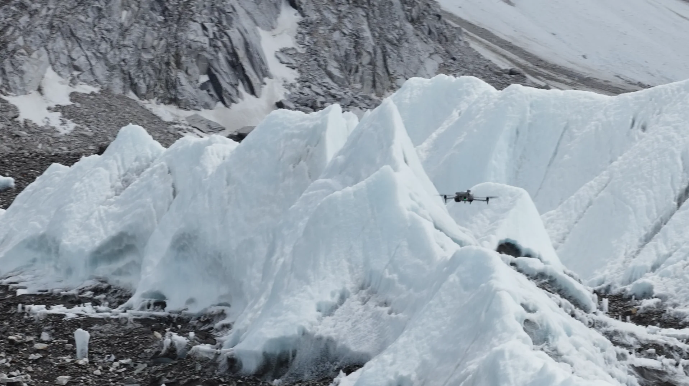
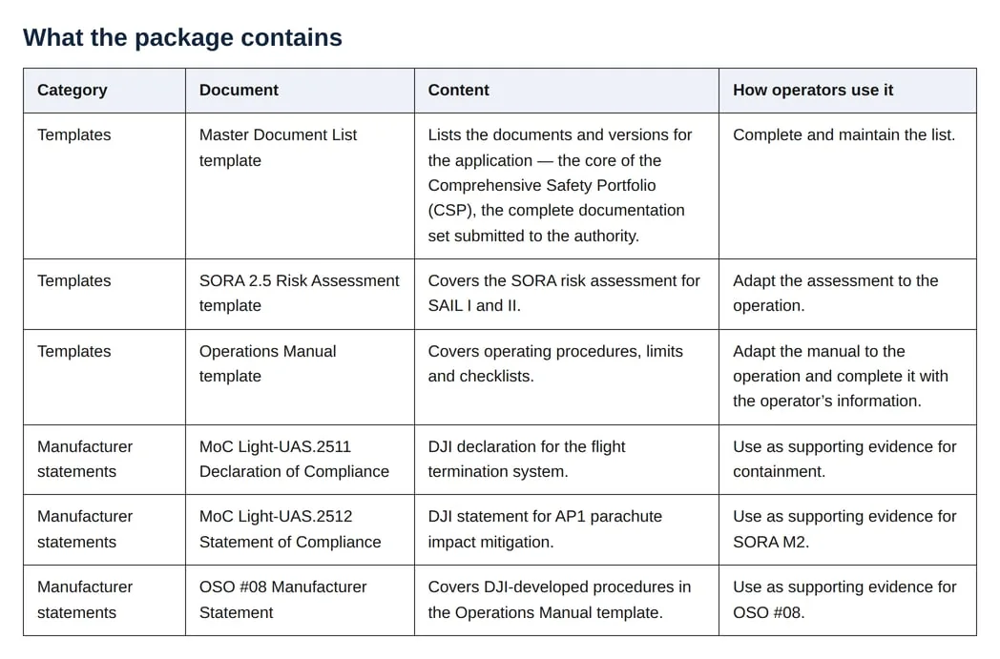

## 도크를 설치하면 원격 비행 준비도 끝날까요? 장비 문서와 현장 위험평가를 나눠 봐야 합니다

시설물 정기점검을 위해 드론 도크를 검토할 때, 장비가 자동으로 이착륙한다는 설명만으로 운용 계획을 마칠 수는 없습니다. **제조사가 입증할 수 있는 장비 안전 기능**과 **운영자가 현장마다 설명해야 할 비행 구역·절차·위험**은 서로 다른 자료입니다.

[2026년 11월 17일 DJI Enterprise Insights](https://enterprise-insights.dji.com/blog/the-dji-dock-4-compliance-document-package-a-head-start-on-european-bvlos-applications)는 유럽의 가시권 밖 비행(BVLOS) 신청을 준비하는 DJI Dock 4 운영자를 위한 문서 패키지를 소개했습니다. 여기서 말하는 대상은 **Dock 4·Matrice 5TD·DJI AP1 낙하산의 지정 구성**이며, SORA 기반 신청 서식은 SAIL I·II를 다룹니다. 이는 **유럽 제도에 관한 제조사 자료**이지 한국에서의 운항 허가나 국내 규정 충족을 뜻하지 않습니다.

출처: [DJI Enterprise Insights, “The DJI Dock 4 Compliance Document Package”](https://enterprise-insights.dji.com/blog/the-dji-dock-4-compliance-document-package-a-head-start-on-european-bvlos-applications), 2026년 11월 17일. 원문 대표 이미지.

## 제조사가 주는 것과 운영자가 채우는 것

DJI가 소개한 패키지에는 문서 목록, **SORA 2.5 위험평가**, **운용매뉴얼** 서식 세 가지와 비행종료 시스템·낙하산·OSO #08에 관한 제조사 선언 세 가지가 포함됩니다. 서식과 선언은 신청에 필요한 자료를 구성하는 데 도움을 주지만, 운영자의 현장 정보를 대신 작성하거나 승인을 보장하지는 않습니다.

출처: [DJI Enterprise Insights, Dock 4 규정 준수 문서 패키지 소개](https://enterprise-insights.dji.com/blog/the-dji-dock-4-compliance-document-package-a-head-start-on-european-bvlos-applications), 2026년 11월 17일. 원문 도표.

운영자는 실제 도크 설치 위치와 비행 경로, 주변 사람·시설·공역의 조건, 정상·비상 운용 절차, **해당 임무의 위험평가**를 채워야 합니다. 같은 기체라도 발전소 외곽 순찰과 공사장 공정 기록은 비행 구역과 제3자 노출 조건이 다릅니다. 따라서 장비 자료를 그대로 현장 승인 자료로 간주할 수 없습니다. 유럽의 경우 최종 운용 허가는 관할 당국이 운영자에게 부여합니다.

## 안전 기능의 ‘존재’와 인정되는 ‘적용 범위’는 다릅니다

DJI의 설명에 따르면 지정 구성의 비행종료 시스템(FTS)은 비행제어기를 거치지 않고 전자변속기(ESC)에 종료 명령을 전달하며, 별도 웹 포털을 이용합니다. 그러나 **MoC Light-UAS.2511 선언이 다루는 범위는 별도 기기에서 DJI FTS 웹페이지를 통한 수동 활성화**입니다. FlightHub 2를 통한 낙하산 전개나 자동 GeoCaging 종료가 그 선언에 포함된다고 해석해서는 안 됩니다.

AP1 낙하산에 관한 **MoC Light-UAS.2512** 자료는 지정된 Matrice 5TD·AP1 구성에서 지면 충돌 에너지 완화에 관한 근거로 제시됩니다. 실제 운용에서 인정받을 완화 조치와 적용 조건은 운영자가 확인해야 합니다. [DJI의 도크 규정 준수 안내](https://enterprise-insights.dji.com/dji-dock-compliance?hsLang=en#resources)도 지역·기체 구성·펌웨어·공식 문서 버전에 따라 적용 범위가 달라질 수 있다고 명시합니다.

## 정기점검 서비스에서는 무엇을 먼저 합의해야 할까요?

아이엠드론은 원격 도크 기반 시설점검을 검토할 때 **점검 대상과 촬영 주기, 운용 구역 및 비상 대응, 영상의 검토·인계 방식**을 고객과 먼저 맞추겠습니다. 장비의 제조사 증빙은 따로 확인하고, 현장별 항로·접근 제한·자료 관리 조건은 운영 계획으로 분리하겠습니다. 이를 통해 ‘도크 설치 가능’과 ‘현장에서 반복 운용 가능한 점검 서비스’를 혼동하지 않도록 돕겠습니다.

이 글은 유럽의 문서 분담 사례를 서비스 설계의 참고 기준으로 소개합니다. 국내 비행 승인·가시권 밖 운항 요건은 실제 운영 장소와 임무에 맞춰 별도로 확인해야 하며, DJI의 발표를 국내 인허가 또는 실제 점검 성과로 해석하지 않습니다.

## 참고한 공식 자료

- DJI Enterprise Insights, [“The DJI Dock 4 Compliance Document Package: A Head Start on European BVLOS Applications”](https://enterprise-insights.dji.com/blog/the-dji-dock-4-compliance-document-package-a-head-start-on-european-bvlos-applications), 2026년 11월 17일. 서식·제조사 선언·적용 구성·이미지 출처.
- DJI Enterprise, [“DJI Dock Compliance”](https://enterprise-insights.dji.com/dji-dock-compliance?hsLang=en#resources), 2026년 11월 18일 열람. 지역·구성·공식 문서 버전에 따른 적용 범위 안내(페이지에 발행일 미표기).
