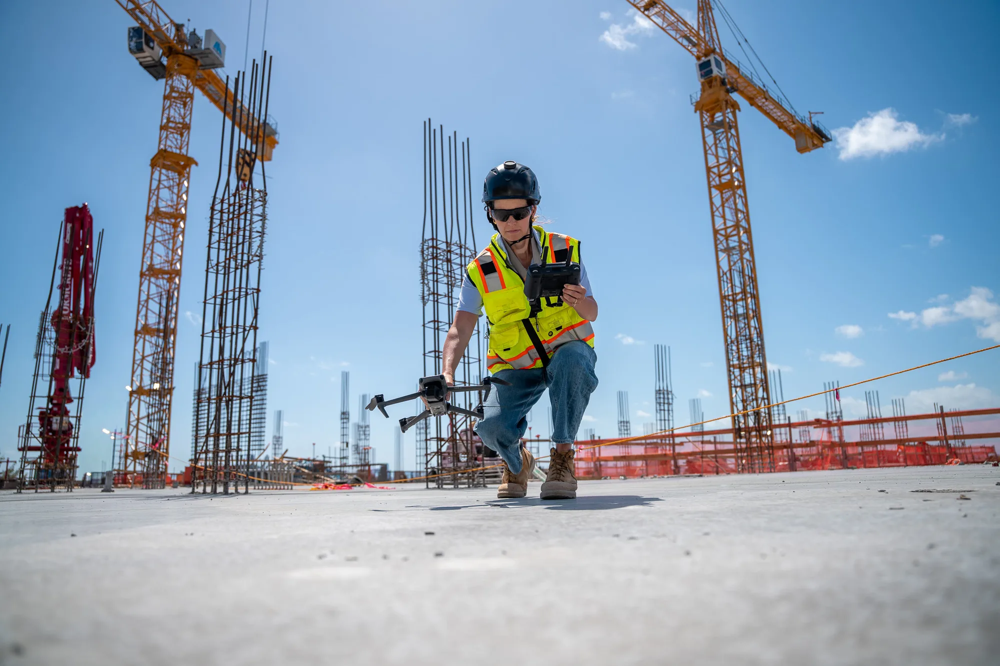
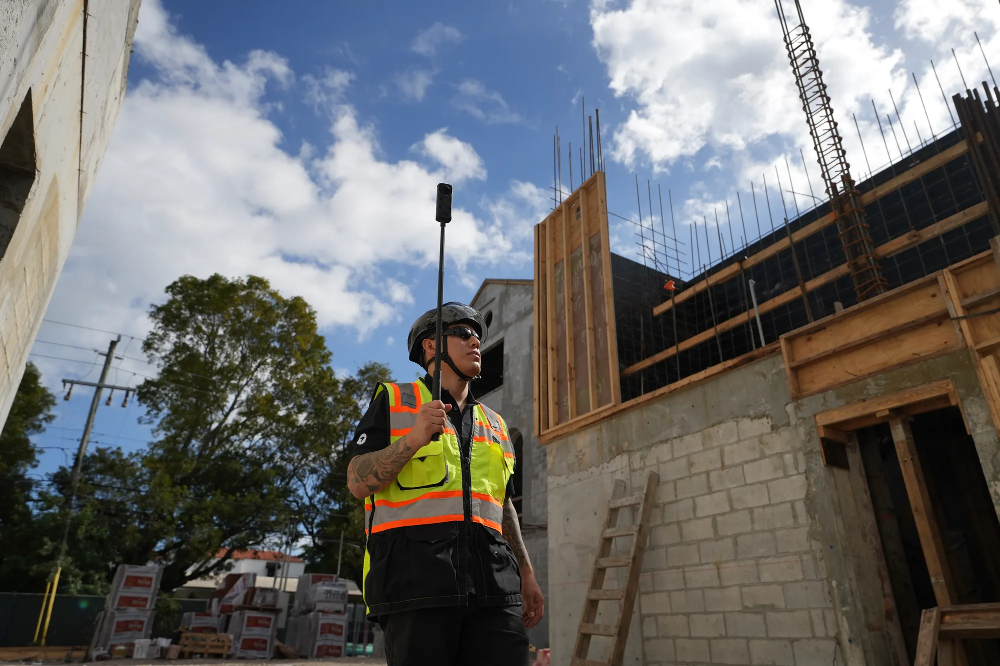

## 벽을 닫기 전 현장 기록, 나중에 무엇을 확인할 수 있어야 할까요?

콘크리트를 타설하거나 벽체와 천장을 마감하면 철근, 매립 부품, 배관과 배선의 위치를 사진만으로 다시 확인하기 어려워집니다. 문제는 촬영 장비보다 **언제, 어디를, 누가 확인할 수 있도록 남겼는가**에 있습니다. 공정이 넘어가기 전 촬영과 검토 시점을 맞추지 못하면 자료가 있어도 필요한 구간을 찾기 어렵습니다.

[DroneDeploy가 2026년 11월 16일 발행한 건설 현장 품질기록 글](https://www.dronedeploy.com/blog/how-to-monitor-construction-site-quality-without-walking-every-floor)은 실내 360도 워크를 도면·날짜와 연결하고, 외부는 정기 항공 촬영으로 기록하는 방식을 설명합니다. 이는 **플랫폼 업체가 제시하는 운영 방법**으로, 특정 현장의 결함 감소율이나 검사 대체 성과를 입증한 사례는 아닙니다.

출처: [DroneDeploy Blog, “How to monitor construction site quality without walking every floor”](https://www.dronedeploy.com/blog/how-to-monitor-construction-site-quality-without-walking-every-floor), 2026년 11월 16일. 원문 현장 사진.

## 촬영 기준은 ‘주 1회’보다 먼저 마감 시점에 맞춰야 합니다

원문은 층별 주간 기록을 기본선으로 삼되, 다음 공정이 가리기 직전 별도의 촬영을 추가하라고 제안합니다. 예를 들어 타설 전에는 슬리브·매립물·철근을, 단열재와 석고보드 설치 전에는 벽체 안쪽 설비를, 천장 마감 전에는 천장 위 설비를 남깁니다. 지붕과 외피도 층별 시공 단계를 구분해 날짜별로 기록하는 편이 나중에 해당 시공 상태를 찾기 쉽습니다.

모든 구역을 같은 빈도로 촬영할 필요는 없습니다. 고객과 먼저 **가려지는 공정, 하자 위험이 큰 구간, 변경이 잦은 위치**를 정하고, 해당 구간의 마감 전 기록이 확보됐는지 확인하는 방식이 실무적입니다. 정기 촬영만으로 마감 직전의 상태가 자동으로 남는 것은 아닙니다.

출처: [DroneDeploy Blog, “How to monitor construction site quality without walking every floor”](https://www.dronedeploy.com/blog/how-to-monitor-construction-site-quality-without-walking-every-floor), 2026년 11월 16일. 원문 360도 워크 사진.

## 도면·위치·날짜가 연결돼야 다시 찾을 수 있습니다

DroneDeploy는 360도 워크를 층별 도면과 날짜에 맞춰 열어 보고, 이전 촬영본과 비교하거나 발견 사항을 영상 위치에 표시하는 기능을 소개합니다. 이 방식의 핵심은 사진을 많이 쌓는 데 있지 않습니다. 마감 이후 특정 벽 뒤에 무엇이 있었는지 질문받았을 때 **해당 층·구역·촬영일의 원본 기록**으로 돌아갈 수 있어야 합니다. 이슈의 분류, 처리 상태와 책임자 기록까지 연결하면 후속 확인에도 도움이 됩니다.

실외 부지와 골조·외피는 드론 항공 촬영으로 전체 변화와 접근 경로를 기록하고, 실내 은폐 부위는 지상 360도 촬영이나 가까운 거리의 사진으로 보완할 수 있습니다. 항공 영상이 벽 안쪽 배관을 보여주지는 않으며, 실내 워크가 외부 전체 공정을 대신하지도 않습니다. 촬영 범위와 사각지대는 인계할 때 함께 밝혀야 합니다.

**영상 검토는 품질시험이나 승인 절차의 대체물이 아닙니다.** 원문 역시 토크 검사, 콘크리트 공시체 시험, 압력 시험, 검사자의 서명을 360도 촬영으로 대체할 수 없다고 명시합니다. 기록은 현장 재확인이 필요한 구간을 찾고 당시 보였던 상태를 설명하는 자료이며, 적합 판정은 별도 시험과 권한 있는 담당자의 확인을 따라야 합니다.

## 고객에게 남겨야 하는 것은 영상 파일보다 확인 가능한 이력입니다

아이엠드론은 건설 현장 기록을 설계할 때 **실외 항공 촬영 범위와 실내 은폐 공정의 촬영 시점**을 분리해 협의합니다. 촬영일, 층·구역, 공정 단계, 원본 파일과 확인이 필요한 위치를 연결해 전달하면 담당자가 현장을 다시 방문하기 전에 확인할 자료를 빠르게 찾을 수 있습니다. 고객 현장의 도면 관리 방식과 검수 절차에 맞춰 자료 인계 형태를 정하는 것이 중요합니다.

이 글은 DroneDeploy의 해외 플랫폼 운영 안내를 참고한 서비스 설계 설명입니다. 국내 현장의 품질 승인이나 안전 검사 요건을 대신하는 지침이 아니며, 특정 현장의 실제 성과로 해석해서는 안 됩니다.

## 참고한 공식 자료

- DroneDeploy Blog, [“How to monitor construction site quality without walking every floor”](https://www.dronedeploy.com/blog/how-to-monitor-construction-site-quality-without-walking-every-floor), 2026년 11월 16일. 마감 전 촬영 시점, 도면·날짜별 기록, 원격 검토의 한계 및 본문 이미지 출처.
