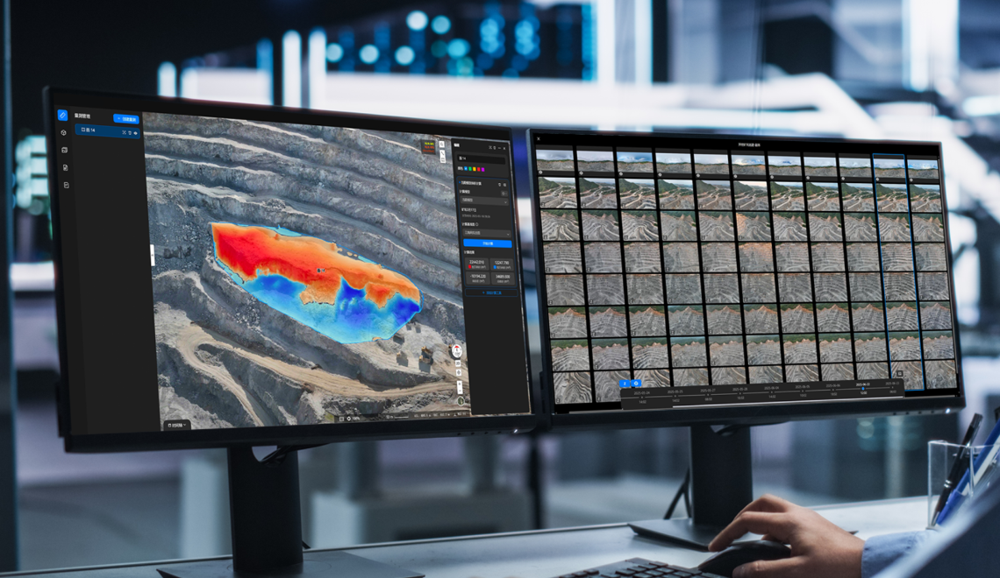
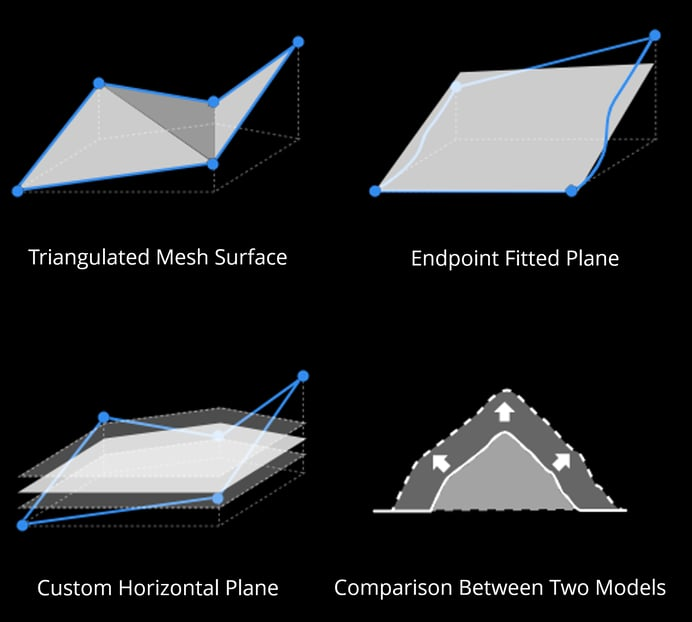

## 골재 야적량을 매번 다르게 계산하지 않으려면 무엇을 고정해야 할까요?

현장의 골재·토사 적치량을 드론으로 한 번 계산하는 일과, **지난달과 이번 달의 물량 변화를 비교하는 일**은 다릅니다. 같은 야적장이라도 적치물의 경계, 체적을 산정할 바닥면, 촬영 시점이 바뀌면 숫자가 달라질 수 있습니다. 고객이 필요한 것이 재고의 추이인지, 반출입 기록의 검토인지, 설계 대비 토공량인지부터 정해야 결과를 사용할 수 있습니다.

[DJI Enterprise가 2026년 11월 19일 공개한 영상 소개](https://x.com/DJIEnterprise/status/2123295414094840136)는 Dock 3·FlightHub 2로 적치물을 추적하는 흐름을 설명합니다. 분석 계획을 설정한 뒤 2D·3D 모델, 체적 계산, 이메일 맞춤 보고서로 이어지는 **제품 활용 예시**입니다. 영상 크레딧은 Geocom Chile로 표기돼 있습니다. 다만 게시물에는 개별 야적장의 측량 오차, 자동 갱신 주기, 절감 성과가 제시돼 있지 않습니다.

출처: [DJI Enterprise Insights, “DJI FlightHub 2 Now Enhanced for AEC”](https://enterprise-insights.dji.com/blog/dji-flighthub-2-construction-update), 2025년 6월 30일. 원문 대표 이미지. 2026년 11월 게시물의 영상 프레임이 아닙니다.

## 기준면이 다르면 같은 적치물도 다른 숫자가 됩니다

DJI의 [2025년 6월 30일 건설·인프라용 FlightHub 2 소개](https://enterprise-insights.dji.com/blog/dji-flighthub-2-construction-update)는 2D 모델, 3D 모델, 점군을 이용한 체적 측정과 절토·성토량 및 시기별 차이 계산을 설명합니다. 현재 모델의 체적을 산정할 때는 삼각망 표면, 끝점에 맞춘 평면, 임의의 수평면 또는 두 모델 간 비교 등 **기준면을 선택**할 수 있다고 명시합니다. 이는 도구가 제공하는 산정 방식이지, 어떤 기준면을 골라도 현장의 실제 재고량과 같다는 뜻은 아닙니다.

예를 들어 적치물의 밑면이 가려져 있다면 사진에서 보이지 않는 부분은 기준면 설정에 의존합니다. 고객과 적치 구역의 경계, 바닥 기준과 경계 밖 제외 구역을 먼저 합의하고, 산출표에는 선택한 방법을 함께 남겨야 합니다. 지형이 바뀌거나 야적 위치가 이동한 뒤에도 이전 기준을 그대로 적용할 수 있는지 확인이 필요합니다.

출처: [DJI Enterprise Insights, “DJI FlightHub 2 Now Enhanced for AEC”](https://enterprise-insights.dji.com/blog/dji-flighthub-2-construction-update), 2025년 6월 30일. 원문 ‘Single-period model volume measurement’ 예시 화면.

## 정기 보고에서는 ‘이번 수치’와 ‘이전 대비 변화’를 나눠 봅니다

DJI 공식 설명은 다른 시기에 촬영한 모델을 겹쳐 절토·성토의 변화를 비교하고, 측정 항목과 표지 등을 지정해 보고서를 정기 생성·전달하는 기능을 소개합니다. 2026년 11월 영상 소개의 이메일 보고 역시 **결과 전달 방식**의 예시입니다. 이메일 발송 자체가 측정값의 검증이나 현장 반출입 물량의 확정은 아닙니다.

반복 측정 자료를 활용하려면 같은 구역을 비교할 수 있도록 촬영 범위와 경계를 기록하고, 각 회차의 촬영일·모델 버전·기준면·계산 구역을 함께 인계해야 합니다. 비가 온 뒤 적치물 형상이나 지면 상태가 달라졌다면 비교 조건의 차이도 표시하는 편이 좋습니다. 수치 차이가 실제 반출입 때문인지, 경계와 기준면의 변경 때문인지 구분할 자료가 있어야 담당자가 다음 조치를 결정할 수 있습니다.

## 고객에게 전달할 것은 검토 가능한 물량 이력입니다

아이엠드론은 토공·골재 현장의 드론 촬영을 논의할 때 **무엇을 얼마나 자주 비교할지, 어떤 기준으로 산정할지**부터 고객과 협의합니다. 항공 촬영 범위, 모델과 체적표, 이전 회차와의 변화, 기준면과 검토가 필요한 구간을 묶어 전달하면 현장 담당자가 물량 변화를 추적하는 데 도움이 됩니다. 실제 측정 방식과 납품 범위는 현장 접근성, 좌표 기준, 검수 목적에 맞춰 정해야 합니다.

위 DJI 자료는 해외 제조사의 기능 소개와 영상 데모입니다. 아이엠드론의 Dock 3 도입·FlightHub 2 연동 실적이나 특정 정확도를 뜻하지 않습니다. 계약 물량 또는 정산에 사용할 결과는 고객이 정한 측량 기준과 별도의 현장 검증 절차에 따라 확인해야 합니다.

## 참고한 공식 자료

- DJI Enterprise X, [“DJI Dock 3 and DJI FlightHub 2 for stockpile tracking”](https://x.com/DJIEnterprise/status/2123295414094840136), 2026년 11월 19일 게시. 분석 계획, 모델·체적 산출, 이메일 보고 흐름; 영상 크레딧 Geocom Chile.
- DJI Enterprise Insights, [“DJI FlightHub 2 Now Enhanced for AEC”](https://enterprise-insights.dji.com/blog/dji-flighthub-2-construction-update), 2025년 6월 30일. 체적 기준면 선택, 시기별 모델 비교, 보고서 기능 및 본문 이미지 출처.
