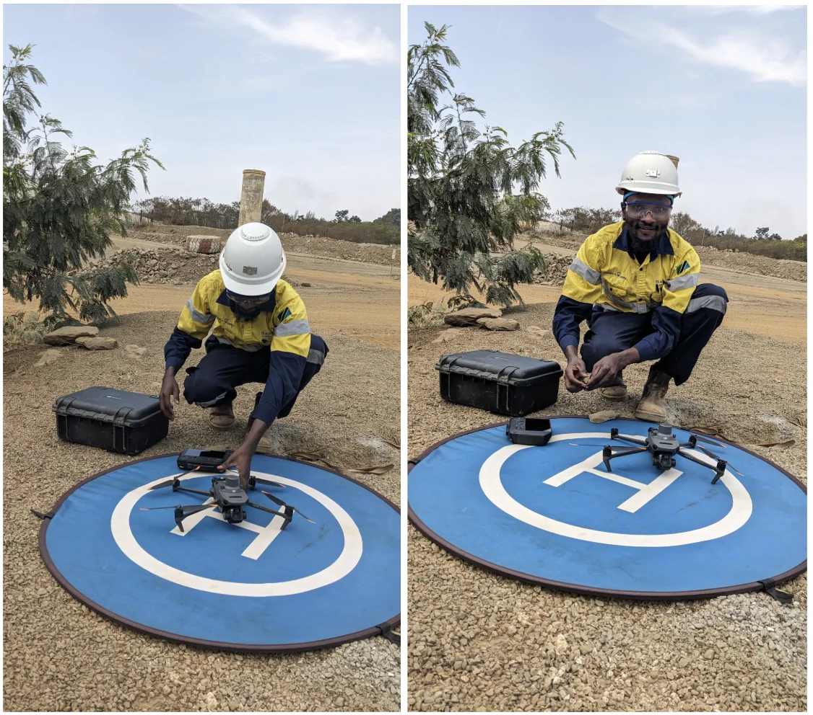
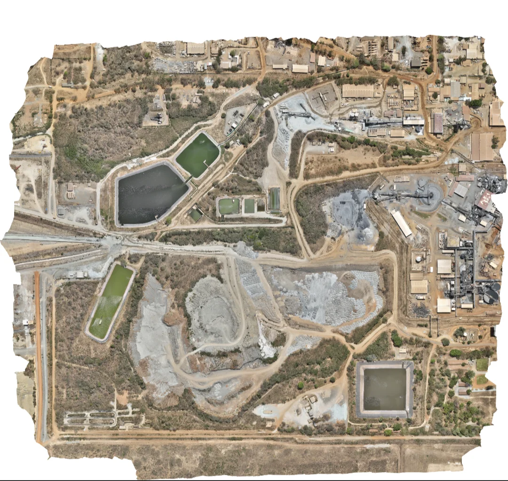

## 광산 드론 측량 결과가 광미댐 계획에 쓰이려면

드론 사진을 많이 찍어도 설계팀이 필요한 물량과 지형 자료를 바로 받는 것은 아닙니다. 폐석을 얼마나 확보할 수 있는지, 어느 구간에서 가져올지 판단하려면 촬영 자료를 현장의 좌표에 맞추고 지형 모델과 체적 분석으로 연결해야 합니다. 광산의 규모와 조건은 일반 건설 현장과 다르지만, **측량 결과를 다음 업무 담당자에게 전달하는 과정**은 토목·산업 현장에서도 참고할 만합니다.

[PIX4D가 2026년 11월 19일 공개한 탄자니아 Bulyanhulu 금광 사례](https://www.pix4d.com/blog/drone-mine-surveying-pix4dmatic/)에서 측량팀의 목적은 폐석 적치장의 가용 물량을 파악해 광미 저장시설(TSF) 엔지니어의 신규 광미댐 및 기존 제방 높이 계획을 지원하는 것이었습니다. 이는 특정 광미댐의 안전성이 드론만으로 검증됐다는 뜻이 아니라, 설계 계획에 필요한 현장 공간 자료를 제공한 사례입니다.

출처: [PIX4D Blog, “Drone-based mine surveying for stockpiles & tailings dams”](https://www.pix4d.com/blog/drone-mine-surveying-pix4dmatic/), 2026년 11월 19일. 원문 현장 사진.

## 사진·기준점·지형 산출물이 함께 움직였습니다

원문에 따르면 측량팀은 **1.32㎢를 496장의 항공 사진으로 촬영**했습니다. 사용 장비로 DJI Mavic 3 Enterprise와 Leica GS16을 명시했고, 지상기준점(GCP)을 이용해 사진측량 결과의 공간 기준을 잡았습니다. PIX4Dmatic 처리 시간은 **35분**, 프로젝트 기간은 **1일**로 기록돼 있습니다. 원문 프로젝트 표의 지상표본거리(GSD)는 **3.9cm**입니다. 이 숫자들은 해당 광산의 현장 기록이지 다른 현장에 적용되는 처리시간·측량 정확도 보증이 아닙니다.

촬영 뒤 나온 결과는 고밀도 점군, 수치표면모델(DSM), 정사영상입니다. 정사영상은 구역의 위치와 형상을 파악하는 데, DSM과 점군은 지형 표면의 높이와 형상을 검토하는 데 쓰일 수 있습니다. 원문은 **전문 광산 체적 계산과 TSF 설계 분석에는 별도의 외부 소프트웨어를 사용했다**고 구분합니다. 사진측량 소프트웨어가 출력한 지형 자료와 설계·체적 검토 결과를 같은 것으로 취급하지 않는 이유입니다.

출처: [PIX4D Blog, “Drone-based mine surveying for stockpiles & tailings dams”](https://www.pix4d.com/blog/drone-mine-surveying-pix4dmatic/), 2026년 11월 19일. 원문 캡션 ‘Orthomosaic of Bulyanhulu Gold Mine’.

## 설계팀에 넘기기 전 확인할 것은 ‘계산 가능한 자료’입니다

광산 사례에서는 지형 자료를 외부 분석 도구로 넘겨 폐석 물량과 광미댐 계획에 연결했습니다. 건설·토목 현장에서도 토사 반출입이나 공정 계획을 검토하려면 촬영 영상만 전달하는 대신 **촬영 범위, 좌표 기준과 기준점, 정사영상·표면모델·점군, 체적 계산의 담당 범위**를 먼저 정해야 합니다. 수량 산정에 사용할 경계·기준면과 별도 검증 측량이 필요한 지점은 발주처 및 설계·측량 담당자와 확인해야 합니다.

현장 운용 조건도 결과에 영향을 줍니다. Bulyanhulu 측량팀은 강풍 때문에 비행 일정을 조정했다고 밝혔습니다. 납품일을 기준으로 촬영 일정을 잡더라도 바람 등 비행 조건이 맞지 않으면 자료 취득을 미루고 대체 일정을 확보해야 합니다. 비행 완료만으로 GCP 적용 상태, 사진 정합 품질, 설계용 분석의 적합성이 자동으로 보증되는 것은 아닙니다.

아이엠드론은 고객이 필요한 결과가 현장 현황 기록인지, 토공 수량 검토인지, 설계팀에 전달할 지형 기초자료인지부터 협의합니다. 그에 맞춰 촬영 범위와 좌표 기준, 산출 형식과 검수 항목을 정하면 현장 사진을 **다음 의사결정에 연결할 수 있는 자료**로 인계하는 데 도움이 됩니다. 위 수치와 광미댐 관련 결과는 PIX4D가 소개한 해외 광산 한 곳의 사례이며, 아이엠드론의 수행 실적이나 국내 현장의 검증 성과를 의미하지 않습니다.

## 참고한 공식 자료

- PIX4D Blog, [“Drone-based mine surveying for stockpiles & tailings dams”](https://www.pix4d.com/blog/drone-mine-surveying-pix4dmatic/), 2026년 11월 19일. Bulyanhulu 금광 측량 인터뷰, 프로젝트 수치, 지형 산출물, 외부 체적·설계 분석 및 본문 이미지 출처.
