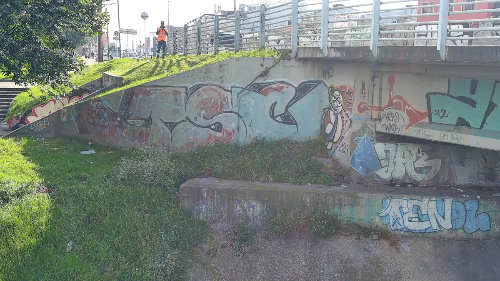
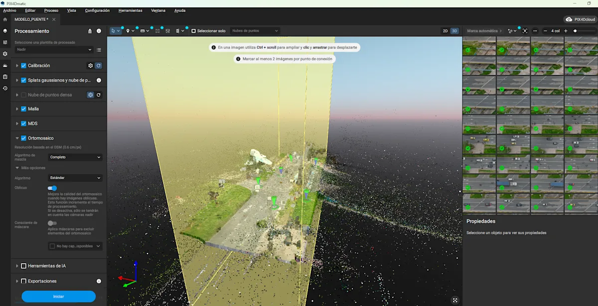

## 교량 점검 드론 사진, ‘찍힌 곳’까지 확인할 수 있어야 합니다

교량 상판은 촬영했는데 하부의 받침·거더는 사진이 부족하다면 점검 자료를 완성하기 어렵습니다. 유지관리 담당자에게 필요한 것은 교량 전경만이 아니라 **어느 부재의 어느 위치에서 무엇을 관찰했는지 다시 찾을 수 있는 기록**입니다. 비행 계획을 세울 때부터 상부와 하부의 접근 조건을 나눠 살펴야 하는 이유입니다.

[PIX4D가 2026년 7월 7일 공개한 콜롬비아 보고타 교량 사례](https://www.pix4d.com/blog/drone-bridge-inspection-pix4d/)에서는 Linear Projects Inspection & Monitoring(LPIM)이 교량 16곳을 드론으로 촬영하고 PIX4Dmatic·PIX4Dcloud를 이용해 자료를 처리·공유했습니다. 원문이 보고한 **현장 점검 시간 75% 단축**은 이 프로젝트의 결과입니다. 국내 모든 교량에서 같은 시간을 절감할 수 있다는 뜻은 아닙니다.

출처: [PIX4D Blog, “Drone bridge inspection with PIX4D”](https://www.pix4d.com/blog/drone-bridge-inspection-pix4d/), 2026년 7월 7일. 원문 현장 이미지(MAX 0598).

## 상판과 하부는 같은 날 촬영되지 않을 수도 있습니다

원문에 따르면 보고타 현장에서는 폭우로 교량 아래 하천·수로의 수위가 올라, 상부 수직 촬영과 하부 촬영을 같은 날 수행하지 못했습니다. 팀은 안전과 자료 품질을 위해 촬영을 나눠 진행했습니다. 교량 점검을 발주할 때 ‘교량 전체 촬영 1회’로만 범위를 정의하면, 하부 접근이 막혔을 때 어떤 부재의 자료가 누락됐는지 드러나지 않을 수 있습니다.

따라서 촬영 전에는 대상 교량의 **상판·측면·하부 및 받침 등 확인할 부위**, 하천 수위와 통행 제약, 촬영 불가 시 재방문 기준을 구분하는 편이 좋습니다. 일정이 분리되더라도 각 구간의 촬영일과 커버리지를 남기면, 먼저 확보한 자료를 검토하면서 빠진 구간의 추가 촬영을 결정할 수 있습니다. 이는 보고타 사례에서 착안한 현장 운용 제안이며, 모든 교량에 동일한 촬영 절차가 적용된다는 의미는 아닙니다.

## 사진 묶음을 위치가 있는 점검 기록으로

LPIM은 촬영 자료를 PIX4Dmatic으로 처리해 정사영상과 3D 자료를 만들고, PIX4Dcloud 링크로 구조 엔지니어와 공유했습니다. 원문은 관찰 사항을 3D 모델의 위치와 연결해 검토하고 이후 변화를 비교할 수 있다는 점을 강조합니다. 보고서에 ‘하부 손상 의심’이라는 문구만 적기보다, 해당 부재의 원본 사진·촬영 시점·모델상 위치를 함께 연결하면 담당자가 재확인할 근거가 생깁니다.

출처: [PIX4D Blog, “Drone bridge inspection with PIX4D”](https://www.pix4d.com/blog/drone-bridge-inspection-pix4d/), 2026년 7월 7일. 원문 ‘3D Point Cloud and Structural Reconstruction’ 이미지.

3D 모델이 만들어졌다고 해서 모든 가려진 면이 촬영되거나 균열·부식이 자동으로 확진되는 것은 아닙니다. 모델의 공백과 원본 사진의 확인 가능 범위를 함께 표시하고, 손상 여부·보수 우선순위는 구조물 점검 담당자의 판단으로 남겨야 합니다. 원문 역시 드론 자료가 측량사와 엔지니어를 대체하는 것이 아니라 이들의 검토를 돕는다고 설명합니다.

아이엠드론은 교량과 산업 시설 점검에서 고객이 확인해야 할 부위와 자료 인계 방식을 먼저 협의합니다. 촬영 가능 범위, 누락 구간, 원본 영상·사진과 위치 기반 3D 기록을 구분해 전달하면 현장 재방문과 엔지니어 검토에 필요한 근거를 더 분명하게 마련할 수 있습니다. 위 16개 교량과 시간 단축 수치는 LPIM의 해외 사례이며 아이엠드론의 수행 실적이 아닙니다.

## 참고한 공식 자료

- PIX4D Blog, [“Drone bridge inspection with PIX4D”](https://www.pix4d.com/blog/drone-bridge-inspection-pix4d/), 2026년 7월 7일. LPIM의 보고타 교량 16곳 촬영, 폭우로 인한 촬영 단계 분리, PIX4Dmatic·PIX4Dcloud 활용, 현장 점검 시간 관련 자료 및 이미지 출처.
