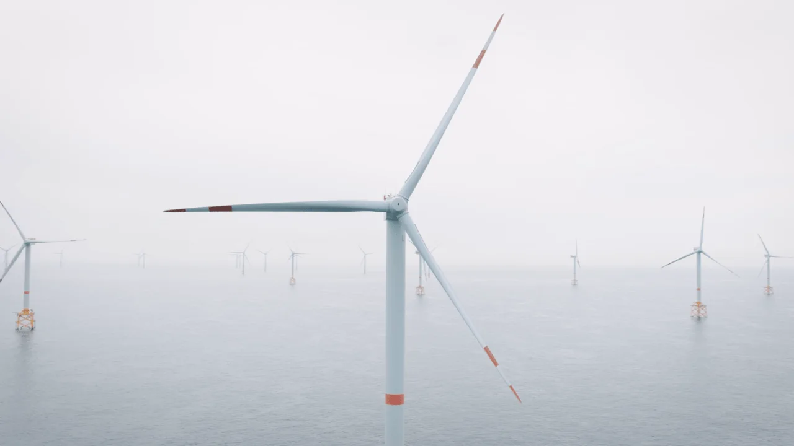
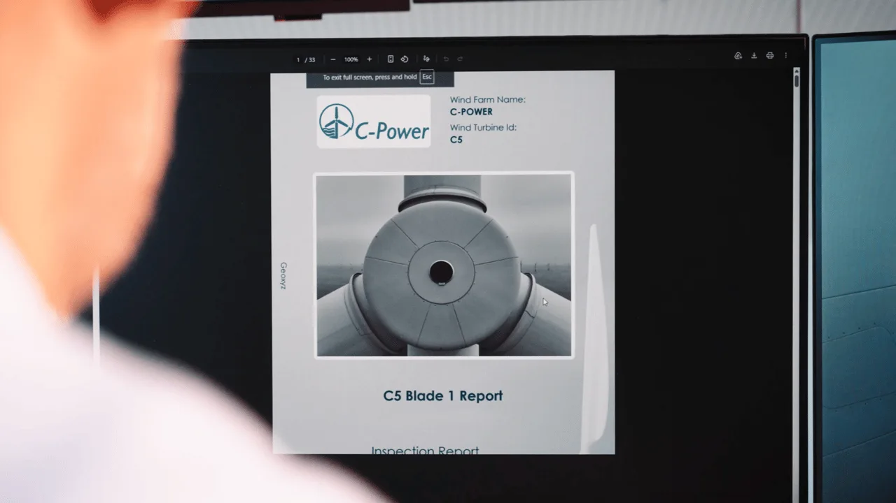

## 해상풍력 블레이드 점검, 사진을 정비 판단으로 연결하려면

풍력발전기 블레이드를 촬영한 사진이 많아도, 어느 터빈의 어느 날개를 언제 촬영했는지 다시 찾기 어렵다면 다음 점검과 보수 계획에 쓰기 어렵습니다. 해상에서는 날씨와 선박 일정까지 맞춰야 하므로 **촬영 범위, 식별 체계, 보고서 인계 방식**을 출항 전에 함께 정하는 것이 중요합니다.

[DJI Enterprise가 2026년 11월 17일 공개한 벨기에 C-Power 해상풍력 사례](https://enterprise-insights.dji.com/user-stories/how-the-dji-matrice-400-is-transforming-offshore-wind-turbine-inspections)에 따르면 GEOxyz는 Matrice 400과 Zenmuse H30 시리즈를 활용해 발전기 54기, 블레이드 162개의 연례 점검을 수행합니다. 이는 **벨기에 사업자의 사례 규모**이지, 국내 현장에 그대로 적용되는 작업량이나 아이엠드론의 수행 실적이 아닙니다.

출처: [DJI Enterprise User Stories, “How the DJI Matrice 400 Is Transforming Offshore Wind Turbine Inspections”](https://enterprise-insights.dji.com/user-stories/how-the-dji-matrice-400-is-transforming-offshore-wind-turbine-inspections), 2026년 11월 17일. 원문 풍력단지 이미지.

## 같은 블레이드를 다시 비교할 수 있는 촬영 계획

DJI 원문은 GEOxyz가 미리 정한 비행 경로에 따라 터빈을 같은 방식으로 촬영한다고 설명합니다. 고소 작업자가 블레이드 외부에 접근하지 않고도 상세 영상을 확보하는 것이 목표입니다. 장비의 성능만큼 중요한 것은 **다음 점검 때도 비교 가능한 자료를 남기는 일**입니다.

현장 인계 범위를 설계한다면 터빈 번호, 블레이드 식별자, 촬영일, 촬영 부위와 원본 사진의 연결 관계를 먼저 정할 수 있습니다. 반복 촬영 시에는 가려진 면이나 확보하지 못한 구간도 함께 기록해야 ‘사진이 없음’을 ‘손상이 없음’으로 오해하지 않습니다. 이 식별·누락 표시는 원문에 기재된 자동 기능이 아니라, 사례를 실무에 적용할 때 아이엠드론이 고객과 협의할 수 있는 자료 관리 방식입니다.

## AI가 찾은 의심 부위와 최종 점검 판단은 다릅니다

원문에 따르면 촬영 이미지는 별도 플랫폼으로 전송되며, 보고서 일부가 자동 생성됩니다. AI는 블레이드 손상 가능성을 식별하는 데 도움을 줄 수 있고, 점검 결과를 바탕으로 추가 확인이나 수리가 결정됩니다. 따라서 AI 표시 결과를 곧바로 손상 확정이나 수리 지시로 읽기보다, **원본 사진과 해당 위치를 담당자가 재검토할 수 있도록** 전달하는 것이 적절합니다.

출처: [DJI Enterprise User Stories, “How the DJI Matrice 400 Is Transforming Offshore Wind Turbine Inspections”](https://enterprise-insights.dji.com/user-stories/how-the-dji-matrice-400-is-transforming-offshore-wind-turbine-inspections), 2026년 11월 17일. 원문 보고 단계 이미지.

발주·운영 관점에서는 원본 사진, 터빈·블레이드별 분류, 의심 부위 표시, 촬영 불가 구간, 후속 확인 상태를 구분해 받는 방식이 유용합니다. 이 항목들은 DJI가 공개한 보고서의 필수 항목이라고 주장하는 것이 아니라, 추후 정비팀이 촬영 결과를 검토하기 위해 제안하는 인계 기준입니다. 원문은 작업 안전성과 시간·비용 측면의 이점을 설명하지만, 해당 사례의 정량적인 절감률은 제시하지 않습니다.

아이엠드론은 풍력·에너지 설비 점검을 논의할 때 촬영 자체뿐 아니라 **무엇을 재확인하고 누구에게 어떤 자료를 넘길지**부터 고객과 정하겠습니다. 해상 촬영의 비행·선박 운용 조건은 현장별로 별도 검토해야 하며, 촬영 사진이 전문 기술자의 구조·정비 판단을 대신하지는 않습니다.

## 참고한 공식 자료

- DJI Enterprise User Stories, [“How the DJI Matrice 400 Is Transforming Offshore Wind Turbine Inspections”](https://enterprise-insights.dji.com/user-stories/how-the-dji-matrice-400-is-transforming-offshore-wind-turbine-inspections), 2026년 11월 17일. GEOxyz·C-Power의 연례 블레이드 점검 규모, 사전 비행 경로, 영상 처리·보고 및 후속 정비 절차와 이미지 출처.
