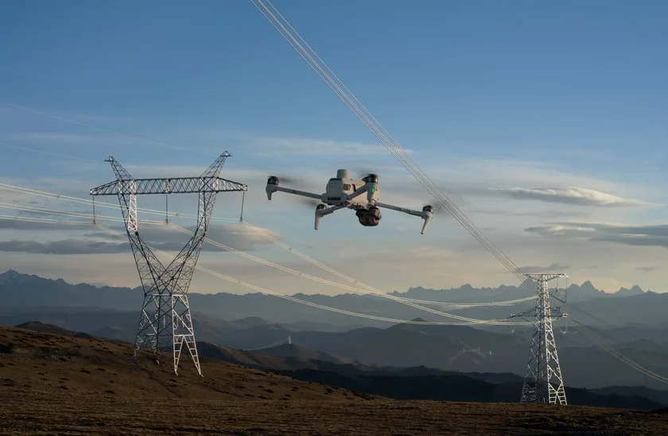
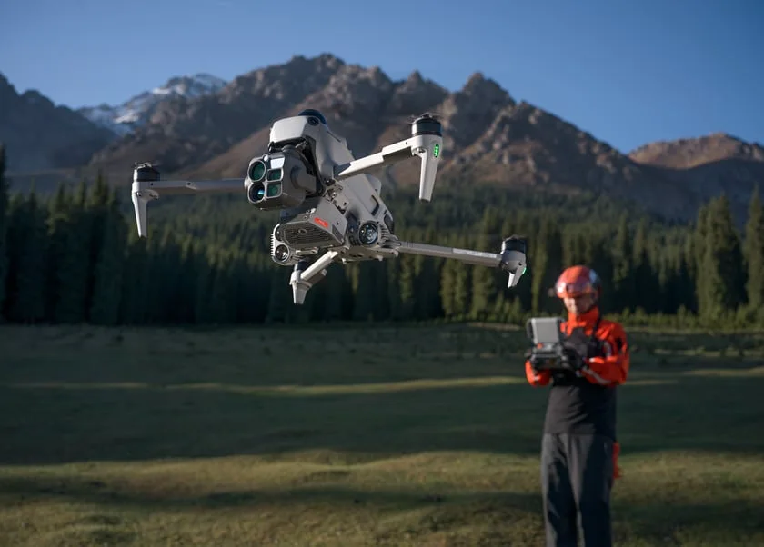

## 송전선로 뒤쪽 구간, 드론 화면이 끊기면 어떻게 점검할까요?

산등성이를 따라 이어지는 송전선로나 굴곡진 계곡을 점검할 때는 촬영 장비의 해상도만으로 작업 가능 구간을 판단하기 어렵습니다. 기체가 능선 뒤로 이동해 조종기와의 통신 경로가 가려지면 영상 확인과 현장 판단이 함께 어려워집니다. **점검 구간을 정할 때 촬영 대상뿐 아니라 통신이 유지되는 위치와 중단 기준도 함께 확인해야 합니다.**

[DJI Enterprise가 2026년 11월 5일 공개한 Matrice 5T 소개](https://enterprise-insights.dji.com/blog/dji-matrice-5t-everything-you-need-to-know)는 직접 통신이 가려지는 지형을 위한 복수의 중계 운용 방식을 설명합니다. 이는 제조사의 장비 기능 소개이며, 국내 송전선로 현장에서의 통신 성능 실증이나 아이엠드론의 해당 장비 운용 실적을 뜻하지 않습니다.

출처: [DJI Enterprise Insights, “DJI Matrice 5T Drone: Everything You Need to Know”](https://enterprise-insights.dji.com/blog/dji-matrice-5t-everything-you-need-to-know), 2026년 11월 5일. 원문 송전선로 점검 이미지.

## ‘최대 전송거리’와 능선 뒤의 연결 가능성은 다릅니다

원문은 O4 Enterprise Enhanced의 **최대 40km** 통신거리를 소개하지만, 이는 **IC 기준의 장애물·간섭이 없는 환경에서 복귀하지 않는 일방향 비행으로 측정한 수치**라고 각주에서 제한합니다. 유럽 CE 등 다른 기준에서는 20km라고 따로 적고 있습니다. 국내의 주파수·출력 및 실제 비행 조건에 이 수치를 그대로 적용하거나, 통신거리만으로 점검 가능 반경을 확정해서는 안 됩니다.

DJI가 소개한 방식은 작업 기체 한 대를 위한 중계 기체 한 대, 중계 기체 한 대가 작업 기체 두 대를 지원하는 방식, 중계 기체 두 대를 연속으로 배치하는 방식입니다. 하나의 조종기로 중계 기체와 작업 기체를 운용할 수 있다는 설명도 있습니다. 다만 **중계 기능이 지형 차폐를 자동으로 해소한다는 보장은 아닙니다.** 기체 사이에 실제로 통신 경로가 유지되는지, 중계 기체의 체공·복귀 여유가 충분한지는 해당 구간에서 검증해야 합니다.

출처: [DJI Enterprise Insights, “DJI Matrice 5T Drone: Everything You Need to Know”](https://enterprise-insights.dji.com/blog/dji-matrice-5t-everything-you-need-to-know), 2026년 11월 5일. 원문 공공안전 현장 이미지이며 중계 구성도는 아닙니다.

## 점검 계획에는 ‘찍을 위치’와 ‘연결할 위치’를 함께 표시합니다

선형 시설 점검을 준비한다면 기체 종류를 먼저 정하기보다 **점검 대상 설비, 촬영 방향, 지형 차폐 구간, 조종·중계 후보 위치**를 동일한 구간도에서 검토할 수 있습니다. 그런 다음 구간별로 통신 상태를 확인하고, 영상이 불안정해질 때 작업을 중단할 기준과 복귀 경로를 정해야 합니다. 이 순서는 DJI 원문이 제시한 표준 운용 절차가 아니라, 현장 계획에 적용할 수 있는 검토 항목입니다.

특히 중계 기체를 추가하면 비행하는 기체 수와 배터리·조종·감시 업무가 늘어납니다. 따라서 점검 구간 전체를 한 번에 비행하는 방식과 작업 지점을 나눠 재배치하는 방식을 비교하고, 각 방식의 자료 누락 가능성도 확인하는 편이 실용적입니다. 원문에서 언급한 휴대전화망 보조 연결은 **해당 지역의 통신망이 있어야** 이용할 수 있으며, 별도 주파수 지원 여부도 국가·지역별로 다릅니다. 야간·악천후·가시권 밖 운용 가능 여부는 국내 법규, 인허가, 현장 안전 조건을 별도로 확인해야 합니다.

## 통신 확보 이후에는 자료의 연결성을 봅니다

드론 영상이 돌아왔다고 점검 결과가 완성되는 것은 아닙니다. 송전탑 번호나 경간, 촬영 시각, 촬영 방향, 열화상과 가시광 사진의 대응 관계를 정리해야 다음 점검에서 같은 지점을 찾을 수 있습니다. DJI 원문은 Matrice 5T의 가시광·열화상 영상과 점검·매핑 기능을 소개하지만, **열화상에서 보이는 이상 후보가 곧 설비 고장 확정이라는 뜻은 아닙니다.** 원본 영상과 당시 운용 조건을 남기고 설비 담당자가 재확인할 수 있어야 합니다.

아이엠드론은 산악·선형 인프라 점검을 논의할 때 고객과 함께 **통신 차폐 구간, 촬영 가능 범위, 중단·재배치 조건, 설비별 자료 인계 방식**을 먼저 확인하겠습니다. 장비 소개 수치가 아니라 현장 시험 결과와 적용 규정을 바탕으로 작업 범위를 정하는 것이 중요합니다.

## 참고한 공식 자료

- DJI Enterprise Insights, [“DJI Matrice 5T Drone: Everything You Need to Know - Night, Rain, and No-Signal Performance”](https://enterprise-insights.dji.com/blog/dji-matrice-5t-everything-you-need-to-know), 2026년 11월 5일. 중계 운용 방식, 통신거리 측정·국가별 지원 조건, 기체 기능 및 본문 이미지 출처.
