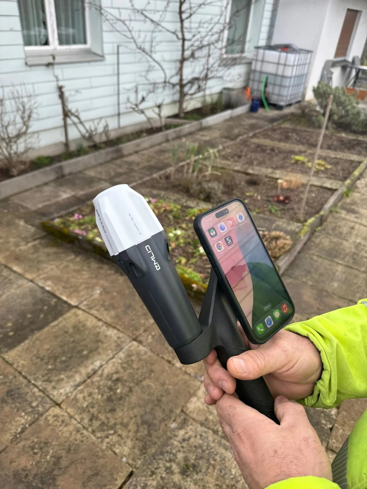
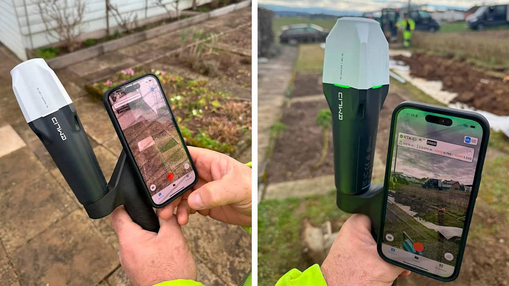

## 광케이블 공사 후, 매설 위치를 GIS에서 다시 찾을 수 있을까요?

통신 관로는 되메우기가 끝나면 사진만으로 실제 배관 경로와 접속 지점의 위치를 되짚기 어렵습니다. 현장에서 기록한 좌표와 시공 도면이 따로 움직이면 유지보수팀은 다시 현장을 확인해야 합니다. **시공 직후의 기록이 운영사의 GIS까지 연결되는지**가 준공 자료의 활용도를 좌우합니다.

[PIX4D가 2026년 9월 2일 공개한 스위스 Multinet Communication AG 사례](https://www.pix4d.com/blog/multinet-digitized-telecommunications-with-pix4d)는 광통신망 개착 공사의 기록을 스마트폰 스캔에서 GIS용 벡터 자료까지 연결한 사례입니다. 이 글은 당시 공개된 해외 사례를 바탕으로 작성했으며, 국내 현장의 정확도나 작업 시간에 관한 검증 결과로 해석해서는 안 됩니다.

출처: [PIX4D Blog, “Digitizing telecommunications infrastructure with PIX4D”](https://www.pix4d.com/blog/multinet-digitized-telecommunications-with-pix4d), 2026년 9월 2일. 원문 “Telecom Construction with PIX4D” 이미지.

## 되메우기 전에 현장에 있는 사람이 기록합니다

PIX4D에 따르면 Multinet은 이전에 매설 시설의 주요 위치를 수작업의 두 점 측정 방식으로 기록했습니다. 공사가 예고 없이 생기거나 짧은 기간에 진행되면 매번 전문 측량 인력을 현장에 보내기 어렵다는 문제가 있었습니다. 이 회사는 **PIX4Dcatch 앱과 RTK 장치**를 이용해 설치팀이 공사 직후 열린 굴착부와 기존·신설 시설을 현장에서 촬영하도록 했습니다.

원문에 소개된 작업은 **스마트폰 기반 지상 스캔이지 드론 측량이 아닙니다.** 부지 전체의 공정과 작업 구간은 항공 영상으로 파악할 수 있지만, 노출된 관로의 연결 관계와 매설 전 세부 형상은 가까운 거리에서 별도로 기록해야 합니다. 서로 다른 촬영 수단의 역할을 구분해야 빠지는 구간을 확인하기 쉽습니다.

## 3D 모델에서 끝내지 않고 운영사 자료 형식까지 봅니다

Multinet 사례에서 현장 수집 자료는 PIX4Dcloud로 전송돼 3D 모델로 처리됐고, 필요한 시설 요소를 **DXF·SHP 벡터 자료**로 추출해 네트워크 운영사의 GIS로 넘겼습니다. 핵심은 화면에서 볼 수 있는 모델 자체보다, 운영사가 사용하는 좌표·선형·시설 속성 기준에 맞게 인수할 수 있느냐입니다. 원문은 PoC에서 현장 취득과 후속 처리 시간이 줄고 수작업 전환에 따른 자료 단절이 줄었다고 설명하지만, 절감률이나 국내 적용 정확도를 제시하지는 않습니다.

출처: [PIX4D Blog, “Digitizing telecommunications infrastructure with PIX4D”](https://www.pix4d.com/blog/multinet-digitized-telecommunications-with-pix4d), 2026년 9월 2일. 원문 “IMA BLO Multinet use case” 이미지.

실무적으로는 발주 단계에서 **좌표계와 기준점, 촬영 시각·구간 식별자, 기존 시설과 신설 시설의 구분, GIS 레이어·속성 정의, 납품 형식**을 함께 정할 필요가 있습니다. 이 항목들은 PIX4D가 제시한 의무 규격이 아니라 국내 현장에 적용할 때 발주자와 확인할 인계 조건입니다. RTK 장치를 사용했다는 사실만으로 최종 성과의 허용오차가 검증되지는 않으므로 필요한 경우 독립 검측과 운영사 수용 기준을 별도로 적용해야 합니다.

## 현장 기록은 나중에 다시 찾을 수 있어야 합니다

설비 담당자가 수리 구간을 찾을 때는 3D 이미지의 선명도만큼 **어느 날짜, 어느 구간, 어느 시설물의 자료인지**가 중요합니다. 아이엠드론은 인프라 현장의 항공 데이터가 필요한 범위와 매설 전 지상 근접 기록이 필요한 범위를 구분하고, 고객의 준공·유지관리 목적에 맞는 위치 기준과 자료 인계 방식을 함께 검토하겠습니다. 실제 현장에 어떤 장비와 측량 절차를 적용할지는 요구 정확도와 안전 조건에 맞춰 결정해야 합니다.

## 참고한 공식 자료

- PIX4D Blog, [“Digitizing telecommunications infrastructure with PIX4D”](https://www.pix4d.com/blog/multinet-digitized-telecommunications-with-pix4d), 2026년 9월 2일. Multinet Communication AG의 개착 통신망 기록, PIX4Dcatch·RTK, PIX4Dcloud 및 DXF/SHP→GIS 인계 사례와 본문 이미지 출처.
