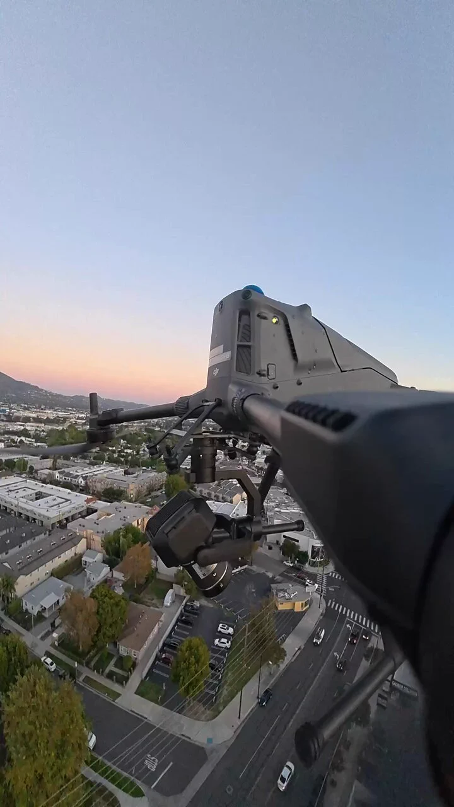

## 사진 192장으로 만든 3D 모델, 우리 현장에서도 같은 결과가 나올까요?

건물의 지붕과 부지를 위에서 촬영한 사진만으로는 외벽이나 측면 구조를 충분히 기록하기 어렵습니다. 발주 목적이 부지 현황도인지, 건축물의 입면을 포함한 3D 모델인지에 따라 촬영 방향과 납품 자료가 달라져야 합니다.

[DJI Enterprise의 2026년 11월 24일 공식 시연](https://x.com/DJIEnterprise/status/2125031817149296946)은 Matrice 400과 Zenmuse P1의 Smart Oblique 기능으로 수직(nadir)·경사(oblique) 사진을 한 비행에서 촬영하고, 사진 **192장**을 DJI Terra에서 3D 모델로 만들었다고 설명합니다. 새 장비 출시나 국내 현장 실증 발표가 아니라 **제조사가 공개한 한 차례의 시연**입니다.

출처: [DJI Enterprise 공식 X, Smart Oblique 시연 게시물](https://x.com/DJIEnterprise/status/2125031817149296946), 2026년 11월 24일. 원문 영상의 대표 이미지(영상 썸네일)이며 측량 결과나 정확도를 증명하는 이미지가 아닙니다.

## 수직 사진과 경사 사진이 맡는 역할

수직 사진은 지붕과 지표면 등 상부에서 보이는 영역의 공간 기록에 쓰입니다. 경사 사진은 건물의 측면과 높이 방향 구조를 여러 방향에서 관찰하는 데 도움이 됩니다. [DJI의 Zenmuse P1 제품 설명](https://enterprise.dji.com/zenmuse-p1)에 따르면 Smart Oblique Capture에서는 짐벌이 각도를 바꿔 사진을 촬영하며, 별도의 상세 모델링 임무는 수직·경사면의 고해상도 기록을 목표로 합니다. **수직·경사 촬영을 함께 했다고 해서 가려진 모든 입면이 자동으로 복원되는 것은 아닙니다.** 처마 아래, 구조물 뒤편, 유리면처럼 사진 정합에 불리한 곳은 별도 확인이 필요합니다.

## ‘192장’은 목표 장수가 아니라 시연 조건의 결과입니다

DJI 게시물에는 촬영 면적, 지상표본거리(GSD), 중복도, 기준점 배치, 처리 시간이나 검측 정확도가 제시되지 않았습니다. 따라서 사진 192장이면 어느 건물이든 같은 품질의 모델이 나온다거나, 모델의 치수를 바로 설계·검측에 쓸 수 있다는 뜻으로 읽어서는 안 됩니다. DJI 제품 페이지의 다른 면적·정확도 수치도 각각 시험 조건이 따로 붙어 있어 이 시연에 그대로 적용할 수 없습니다.

고객이 모델에서 실제로 확인하려는 대상부터 정해야 합니다. 예를 들어 외벽 설비의 위치를 찾으려는지, 공정별 형상을 비교하려는지, 치수를 측정하려는지에 따라 촬영 거리·각도와 검증 기준이 달라집니다. 치수 활용이 필요하다면 좌표계, 기준점 또는 RTK 상태, 독립 검측점과 허용 오차를 사전에 합의하고 결과와 함께 기록해야 합니다. 이는 DJI가 이번 시연에서 공개한 검증 결과가 아니라, 현장 자료를 의사결정에 쓰기 위해 별도로 설계할 검토 항목입니다.

## 납품할 때는 모델의 ‘보이는 곳’과 ‘검증된 곳’을 구분해야 합니다

3D 모델을 건설·시설관리 자료로 전달할 때는 촬영일과 대상 구역, 원본 사진, 모델의 좌표계·처리 조건, 사각지대와 검측 결과를 같이 확인할 수 있어야 합니다. 시각화에 충분한 모델이라도 모든 면의 측정 정확도가 확보된 것은 아닙니다. 특히 날짜가 다른 모델을 비교한다면 같은 기준으로 위치를 맞추고 촬영 누락 구간을 표시해야 잘못된 변화 판정을 피할 수 있습니다.

아이엠드론은 3D 현장 기록을 논의할 때 **무엇을 측정·비교할 것인지**부터 확인하고, 촬영 범위와 수직·경사 영상의 역할, 검증 방법, 자료 인계 형식을 고객과 함께 정하겠습니다. 사진 장수보다 중요한 것은 필요한 면이 충분히 기록됐는지, 그리고 결과를 어떤 판단에 쓸 수 있는지가 분명한 자료입니다.

## 참고한 공식 자료

- DJI Enterprise 공식 X, [“Smart Oblique on the DJI Matrice 400 drone with the Zenmuse P1”](https://x.com/DJIEnterprise/status/2125031817149296946), 2026년 11월 24일. 수직·경사 한 비행 촬영, 192장 DJI Terra 모델 제작 시연 및 본문 영상 대표 이미지 출처.
- DJI Enterprise, [“Zenmuse P1” 제품 페이지](https://enterprise.dji.com/zenmuse-p1), 게시일 미표기(2026년 11월 26일 확인). Smart Oblique 짐벌 촬영 방식과 상세 모델링 기능 설명.
