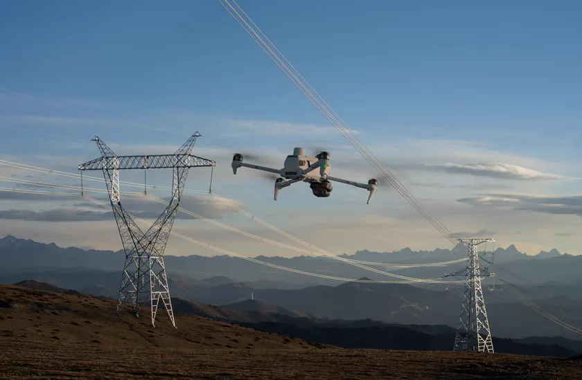

## 송전설비 이상 위치, 레이저로 찍으면 바로 정비할 수 있을까요?

송전선로를 따라 촬영한 영상에서 이상이 의심되는 부위를 발견해도, 정비팀이 같은 부위를 다시 찾지 못하면 점검 자료의 활용도는 떨어집니다. 설비 이름과 철탑 번호, 발견 시각, 촬영 방향을 연결해 두는 일이 필요한 이유입니다.

[DJI Enterprise가 2026년 11월 5일 공개한 Matrice 5T 설명](https://enterprise-insights.dji.com/blog/dji-matrice-5t-everything-you-need-to-know)에는 레이저 거리측정기로 최대 3km 거리까지 측정해 지점을 지정하고, 선·면적을 계산할 수 있다는 내용이 있습니다. 열화상과 가시광 영상을 조종기 화면에서 겹쳐 볼 수 있다는 기능도 소개합니다. 이는 **제조사의 장비 기능 설명**이지, 국내 송전설비에서 위치 오차나 결함 판정 성능을 검증한 현장 결과는 아닙니다.

출처: [DJI Enterprise Insights, “DJI Matrice 5T Drone: Everything You Need to Know”](https://enterprise-insights.dji.com/blog/dji-matrice-5t-everything-you-need-to-know), 2026년 11월 5일. 원문 ‘DJI Matrice 5T powerline inspection’ 이미지. 실제 점검 위치나 거리측정 정확도를 입증하는 사진은 아닙니다.

## 화면의 ‘지점 지정’과 설비의 ‘부품 식별’은 다릅니다

멀리 있는 표적을 레이저로 가리켜 지도에 표시하더라도, 표시된 지점만으로 어느 철탑의 어느 애자련·접속부인지 확정하기는 어렵습니다. 기체 위치와 방향, 표적의 가림 여부, 레이저가 닿은 표면을 함께 확인해야 합니다. 특히 반복되는 유사 부품이나 여러 회선이 겹쳐 보이는 구간에서는 지도 표식과 실제 정비 대상이 어긋날 수 있습니다. DJI 자료의 ‘최대 3km’는 측정 가능 거리 설명이며, 그 거리에서 모든 현장의 부품 식별이나 측위 정확도를 보장한다는 뜻은 아닙니다.

열화상에서 온도 차이가 보인다면 같은 시점의 가시광 영상으로 설비 형태를 확인하고, 자산번호와 촬영 위치를 함께 기록해야 합니다. 온도 차이는 이상 **후보**를 가리는 단서입니다. 전기적 결함 확진이나 긴급 보수 여부는 운전 조건과 주변 환경, 현장 계측 및 시설관리자의 판단을 거쳐야 합니다.

## 정비팀에 넘길 기록은 무엇인가요?

점검을 의뢰할 때 **대상 설비 목록과 식별 기준**을 먼저 정해 두면 촬영 후 자료를 다시 분류하는 일을 줄일 수 있습니다. 현장별로 다음 항목을 확인하는 방식이 유용합니다.

- 철탑·회선·구간 및 부품 식별번호: 화면에 보이는 대상을 기존 자산대장과 대조할 수 있는가
- 원본 열화상·가시광 자료와 촬영 시각: 같은 의심 부위를 두 영상에서 다시 찾을 수 있는가
- 지도 표식, 촬영 방향과 주변 기준물: 지도상의 위치와 실제 접근 지점을 구분해 전달할 수 있는가
- 미확인 구간과 재확인 요청: 가림, 거리, 온도 반사 등으로 판정하기 어려운 부분을 표시했는가

레이저 표식이 정확히 어떤 부품을 가리키는지 애매할 때는 ‘확정 위치’로 넘기기보다 후보 위치와 추가 확인 필요 사항을 함께 남겨야 합니다. 위치 오차의 허용 범위나 설비별 촬영 거리는 현장 구조와 정비 절차에 맞춰 별도로 합의할 항목입니다.

아이엠드론은 송전·배전 설비의 드론 점검에서 단순한 이상 장면 수집에 그치지 않고, 고객의 자산대장과 연결할 수 있는 촬영·위치 기록 형식을 먼저 확인하겠습니다. 발견된 의심 부위를 현장 재확인과 정비 업무에 연결할 수 있어야 점검 데이터가 실제로 쓰입니다.

## 참고한 공식 자료

- DJI Enterprise Insights, [“DJI Matrice 5T Drone: Everything You Need to Know - Night, Rain, and No-Signal Performance”](https://enterprise-insights.dji.com/blog/dji-matrice-5t-everything-you-need-to-know), 2026년 11월 5일. 레이저 거리측정·열/가시광 화면 중첩 기능 설명 및 본문 이미지 출처.
