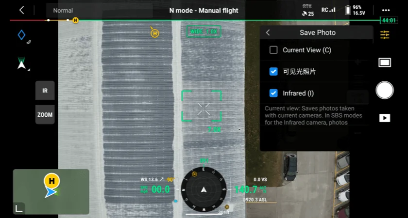
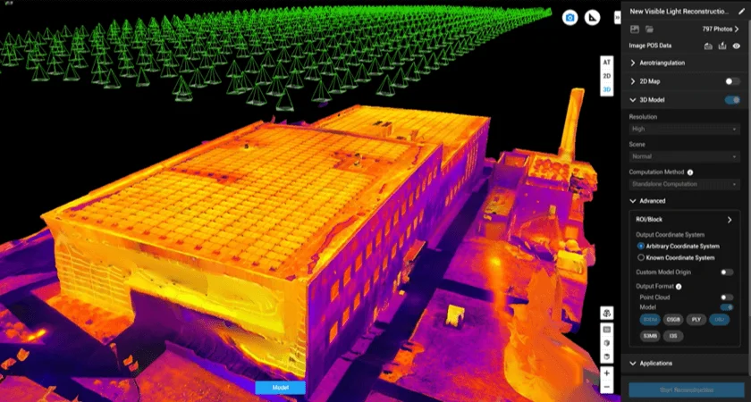

## 지붕 열화상에서 밝게 보이는 곳, 바로 누수 지점일까요?

대형 건물의 지붕에는 방수층뿐 아니라 공조기, 배기구, 태양광 설비와 관통부가 함께 있습니다. 열화상 화면에서 주변과 다른 영역을 발견해도 그것만으로 누수나 단열 결함을 확정할 수는 없습니다. 관리자가 실제로 필요한 것은 **어느 지붕 구역을 왜 다시 확인해야 하는지**가 남는 기록입니다.

[DJI Enterprise의 2026년 11월 26일 게시물](https://x.com/DJIEnterprise/status/2125832409505509469)은 Matrice 5T의 지붕·태양광 점검 활용과 가시광·열화상 융합, 최대 176배 줌을 소개합니다. 이는 제조사의 기능 소개이며 특정 건물의 누수 탐지 성능이나 국내 현장 실증 결과를 뜻하지 않습니다. 지붕 점검의 촬영·처리 절차는 DJI Enterprise가 **2023년 1월 29일** 공개한 [지붕 점검 워크플로](https://enterprise-insights.dji.com/blog/roof-inspection-workflow)를 참고할 수 있습니다. 해당 워크플로는 Mavic 3E 중심의 과거 자료이므로 Matrice 5T에 촬영 설정을 그대로 적용하는 자료로 보아서는 안 됩니다.

출처: [DJI Enterprise Insights, “Roof Inspection Workflow with Mavic 3E”](https://enterprise-insights.dji.com/blog/roof-inspection-workflow), 2023년 1월 29일, 원문 ‘Visual and Thermal’ 이미지. Matrice 5T 촬영 결과는 아닙니다.

## 같은 지붕도 점검 목적에 따라 촬영 시간이 달라집니다

DJI의 워크플로는 균열 등 가시광으로 확인할 항목과 열 패턴을 살필 항목을 구분합니다. 열 점검에서는 햇빛에 의한 가열이 줄어든 해 질 무렵을 고려하고, 누수 의심 구역은 비가 온 직후 남아 있는 물 때문에 해석이 어려울 수 있다고 설명합니다. 반대로 균열·이음부의 외관을 어두운 시간대 가시광 촬영 한 번으로 충분히 확인하기는 어렵습니다. **하나의 비행으로 모든 결함을 판정한다고 약속하기보다**, 점검 목표와 기상·일사·표면 상태에 맞는 자료 확보 계획을 세워야 합니다.

촬영 전에 지붕 평면도나 구역 이름, 공조기와 태양광 설비의 위치, 과거 누수 신고 지점을 확인하면 서로 다른 열 패턴을 같은 ‘이상’으로 묶는 오류를 줄일 수 있습니다. 열화상에서 확인한 위치는 가시광 원본의 같은 지점 및 실제 지붕 구역과 대조해야 합니다. 이는 DJI 사례를 현장 기록에 적용할 때 필요한 운영 기준이며, 열화상만으로 방수층 하부 상태를 입증한다는 뜻은 아닙니다.

## 열 3D 모델과 온도 판독용 원본은 같은 자료가 아닙니다

DJI의 2023년 워크플로는 가시광·열화상 데이터셋을 별도로 처리하도록 권장하고, 2D 지도와 3D 모델을 결과물로 제시합니다. 동시에 DJI Terra가 **온도값을 보존한 열영상 모자이크 결과를 보장하지 않는다**고 명시합니다. 따라서 보기 쉬운 열 지도나 3D 화면만으로 온도값을 확정하거나 수리 범위를 산정해서는 안 됩니다. 의심 구역의 온도 검토가 필요하다면 촬영 당시의 열화상 원본과 분석 조건을 함께 보존해야 합니다.

출처: [DJI Enterprise Insights, “Roof Inspection Workflow with Mavic 3E”](https://enterprise-insights.dji.com/blog/roof-inspection-workflow), 2023년 1월 29일, 원문 ‘3D Model Thermal’ 이미지. 시각화 예시이며 온도 판독 정확도의 증거는 아닙니다.

관리자에게 전달할 결과물은 지붕 구역별 가시광·열화상 원본, 촬영 시각과 당시 기상, 의심 위치의 지도 표식, 판독을 방해한 장애물·고인 물, 그리고 **현장 재확인 필요 여부**로 나누는 편이 유용합니다. 열 패턴의 원인이 일사, 설비 운전, 습기 또는 단열 상태 중 무엇인지는 건물 내부 조사와 시설관리자의 확인을 거쳐 판단해야 합니다.

아이엠드론은 건물 지붕과 태양광 설비 점검에서 촬영 영상만 전달하는 대신, 고객이 구역별로 비교하고 현장 점검 우선순위를 정할 수 있도록 가시광·열화상 자료의 위치와 촬영 조건을 함께 기록하겠습니다. 실제 누수·방수 보수 판단은 현장 확인 결과와 결합되어야 합니다.

## 참고한 공식 자료

- DJI Enterprise X, [“DJI Matrice 5T drone for roof and solar inspection”](https://x.com/DJIEnterprise/status/2125832409505509469), 2026년 11월 26일. 장비 활용·줌·영상 융합 기능 소개.
- DJI Enterprise Insights, [“Roof Inspection Workflow with Mavic 3E”](https://enterprise-insights.dji.com/blog/roof-inspection-workflow), 2023년 1월 29일. 촬영 조건, 가시광·열화상 처리 구분, 열 모자이크 온도 판독 제한 및 이미지 출처.
